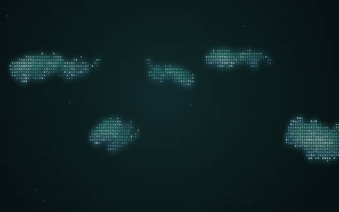

# ASCII Animals

Procedural animals drawn with moving characters, using a framework-neutral Canvas 2D engine. The current implementation is a cuttlefish: a tapered mantle, rippling skirt fins, raised eyes, eight arms, two longer tentacles, and a beak, directed through a fixed diver's view. A school can mix roles and sizes, follow a shared route, and react to disturbances with a character-based ink plume.

**Canvas 2D · zero runtime dependencies · explicit lifecycle · per-animal ESM entry · local review candidate**

## Review status and source

Integration review: see [independently rerun checks and remaining blockers](docs/INTEGRATION-REVIEW.md). This is a draft review branch, not a released npm package.

This README accompanies a local package candidate based on [PR #1's import commit `7e5984d34a139b8de4643f1ed0607897a42d88dc`](https://github.com/castlemilk/ascii-animals/commit/7e5984d34a139b8de4643f1ed0607897a42d88dc), branch `feat/cuttlefish-microsite-import`. Its imported files match the inspected local site snapshot `afcce9941c5fa13ca5c658564e73388e603dff14`; local hosting metadata is excluded from the import. The original `main` read contained only `.gitignore` at `84bd1f84fab0f5f5dec053c0d10562c10be8c188`.

The accessible saved microsite version 4 points to the older source commit `6214a09171fa328beec984edd6533c33e83ce9f1`. Site metadata links it to the supplied [Cuttlefish conversation](https://chatgpt.com/c/6afd2c72-71ec-83ec-b182-835c5e7f86b1), but this review could not read the full conversation or inspect the live runtime. Do not assume the saved site, import branch, and candidate are identical.

The local package is named `ascii-animals-review@0.0.0-review.0`, with `private: true` and `license: "UNLICENSED"`. It has not been published. A final package name, license, browser support matrix, and visual/performance acceptance remain owner decisions. The microsite, recorder and standalone now use a generated browser-global build of the same canonical `src/` engine. A frozen legacy renderer remains only under `test/fixtures/` for compatibility checks.

[API guide](docs/API.md) · [Architecture](docs/ARCHITECTURE.md) · [Extension guide](docs/EXTENDING.md) · [Release checks](docs/RELEASE.md) · [Backlog drafts](docs/BACKLOG.md)

## See the existing cuttlefish

The imported demo supports a school of 1–12 animals, individual roles, horizontal/vertical/diagonal/random routes, stable size variation, three palettes, glyph/point rendering, and pointer or button-triggered reactions. These GIF assets are retained from the import, whose README describes them as recordings. They are not evidence that the hardened candidate has passed new browser QA.



| Scene / direction | Behavior |
| --- | --- |
| Swim-by | The original single animal enters quickly, lingers, then leaves. |
| Close encounter | The original single animal approaches the lens and continues asymmetric arm movement during its hold. |
| Startle & ink | Eligible animals react, spray, then move away. |
| Independent school | Each animal uses its assigned or scene-derived role. |
| Horizontal / vertical / diagonal / random | The selected formation takes precedence over individual roles. |

The original solo scenes require one animal, independent formation, and the `'auto'` role. A school has different composition and role selection; increasing population does not reproduce twelve identical solo performances.

Serve the imported demo without installing dependencies:

```sh
python3 -m http.server 8000 --directory dist
```

Open `http://localhost:8000`. The standalone `dist/cuttlefish.html` opens locally without dependencies. Run `npm run build` after source changes to generate both ESM package output and the browser-global/standalone demos from canonical `src/`. `python3 scripts/build-standalone.py` remains a compatibility command and invokes the same canonical demo generator. Run `node scripts/build-demo.mjs --check` to reject stale committed output.

## Build and try the local library candidate

Use the included source and a local tarball. Do not infer registry availability from these examples.

```sh
npm run build
npm run check:package
npm pack --dry-run --json --ignore-scripts
npm pack --json --ignore-scripts
```

After inspecting the tarball, install that local file in a temporary consumer with scripts disabled:

```sh
npm install --offline --ignore-scripts --no-audit --no-fund \
  /absolute/path/to/ascii-animals-review-0.0.0-review.0.tgz
```

An application can import the animal entry:

```js
import { createCuttlefish } from 'ascii-animals-review/cuttlefish';

const canvas = document.querySelector('#cuttlefish');
const artwork = createCuttlefish(canvas, {
  count: 4,
  scene: 'reactive',
  formation: 'independent',
  behaviors: ['hover', 'orbit', 'cruise', 'curious'],
  size: 0.7,
  density: 1.1,
  paused: true
});

document.querySelector('#play').addEventListener('click', () => {
  artwork.setPaused(false); // Deliberate Play action.
});
document.querySelector('#pause').addEventListener('click', () => {
  artwork.setPaused(true);
});
document.querySelector('#startle').addEventListener('click', () => {
  artwork.pulse(); // Does not silently resume a paused candidate.
});

// Update an existing instance; preserve ownership of its canvas.
artwork.setOptions({ formation: 'vertical', reverse: false });

// On component/page teardown:
// artwork.destroy();
// Also remove the application's button listeners or use AbortController.
```

The matching host markup needs an explicit CSS size and an accessible description:

```html
<canvas id="cuttlefish" role="img"
  aria-label="A school of cuttlefish drawn with luminous characters"
  style="display:block;width:100%;height:480px"></canvas>
<button id="play" type="button">Play</button>
<button id="pause" type="button">Pause</button>
<button id="startle" type="button">Startle cuttlefish</button>
```

The engine does not create the application's controls. Decorative use should hide the canvas from assistive technology and avoid pointer/focus obligations. Meaningful artwork needs text explaining its behavior. The visible characters are rasterized glyphs, not selectable terminal text.

## Imports, SSR, and ownership

| Import | Contents |
| --- | --- |
| `ascii-animals-review/cuttlefish` | `CuttlefishArtwork`, `createCuttlefish`, and cuttlefish types |
| `ascii-animals-review/core` | `createScheduler` and scheduling types |
| `ascii-animals-review` | Convenience entry; see its declaration file for exports |

ESM import is designed to be safe during SSR: importing does not create canvases or access browser globals. Construct an animal only after a browser canvas exists. The candidate does not claim server-side image rendering. There is no React runtime dependency or published React adapter; [the extension guide](docs/EXTENDING.md) includes an explicit draft integration example.

TypeScript root/animal consumers need the `DOM` library for `HTMLCanvasElement`.
The `./core` declarations also work in a DOM-free TypeScript project.

Eligible automatic instances share a per-window scheduler. Paused, hidden, offscreen, zero-sized, and destroyed instances contribute no automatic frames. `destroy()` is idempotent and removes owned work; host controls and polling remain the host's responsibility. The candidate follows reduced motion by default. An explicitly supplied `paused: false` or a later `setPaused(false)` is deliberate playback intent; choose it with care in host code.

The package includes explicit resource limits: default DPR ceiling 2, main-canvas backing-store ceiling 8,294,400 pixels, per-grid ceiling 65,536 cells, and automatic cadence ceiling 60 fps (configurable from 10 to 120). Glyph atlas resolution is bounded separately. These are individual bounds and requested cadence, not a total-memory bound or a promise of 60 fps on every device. Effective quality can be lower on oversized canvases. See [API.md](docs/API.md) for the full option contract and compatibility changes.

## Controlled stepping

For numerical tests or a controlled browser capture, create with `autoStart: false` and call `advance(dtSeconds)` with a finite duration from 0 to 0.1 seconds:

```js
const artwork = createCuttlefish(canvas, { autoStart: false, paused: true });
artwork.restart();
for (let frame = 0; frame < 120; frame++) artwork.advance(1 / 60);
```

An explicit manual step advances while paused. It is not an arbitrary-time seek operation. Repeatability requires the same options, viewport, input sequence, and step sequence. Pixels may differ across browser fonts and rasterizers, and ink integration is not promised to be independent of frame partition.

## Performance and validation

The existing renderer already reuses a geometry buffer, depth-buffer arrays, cached glyph atlases, and grid-sized glow surfaces. The candidate concentrates on lifecycle, bounded resources, packaging, and repeatable measurements. No GPU renderer rewrite is required for this stage.

The imported numerical check remains available:

```sh
node scripts/check-engine.cjs
```

That test uses a stubbed Canvas context. It checks numerical/behavioral conditions; it does not establish visual correctness, real Canvas speed, browser compatibility, or accessibility. The review's verification log records tests actually run, source hashes, fixture/bundler versions, benchmark samples, and acceptance still open. Proposed budgets and calculated memory capacities are labeled separately from measurements. The release guide contains the complete consumer and browser matrix.

## Project layout

| Path | Purpose |
| --- | --- |
| `src/animals/cuttlefish.js` | Candidate ESM implementation derived from imported renderer |
| `src/core/` | Injectable shared scheduling support |
| `types/` | Public declarations, mirrored into the built package |
| `lib/` | Generated package files |
| `fixtures/` | Package consumer, bundler, and type-check inputs |
| `dist/` | Microsite; generated canonical browser engine and standalone demo |
| `scripts/` | Build, package checks, original numerical checks, standalone/GIF utilities |
| `docs/` | API, architecture, extension, release, source references, and backlog drafts |

## Origin and license status

The imported README describes the geometry, motion, renderer, and microsite as original procedural JavaScript inspired by a supplied luminous ASCII jellyfish reference. This review inspected code and provenance metadata, not the original video's licensing chain, and did not copy code or artwork from that video. No LICENSE was present in the inspected import. The candidate retains source attribution and stays `UNLICENSED` until the owner chooses and supplies an appropriate license. No external animal assets, models, or runtime libraries have been introduced.
