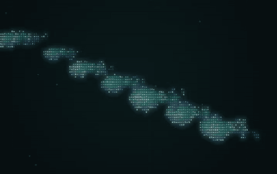
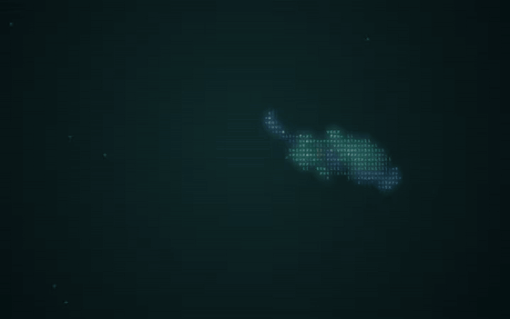
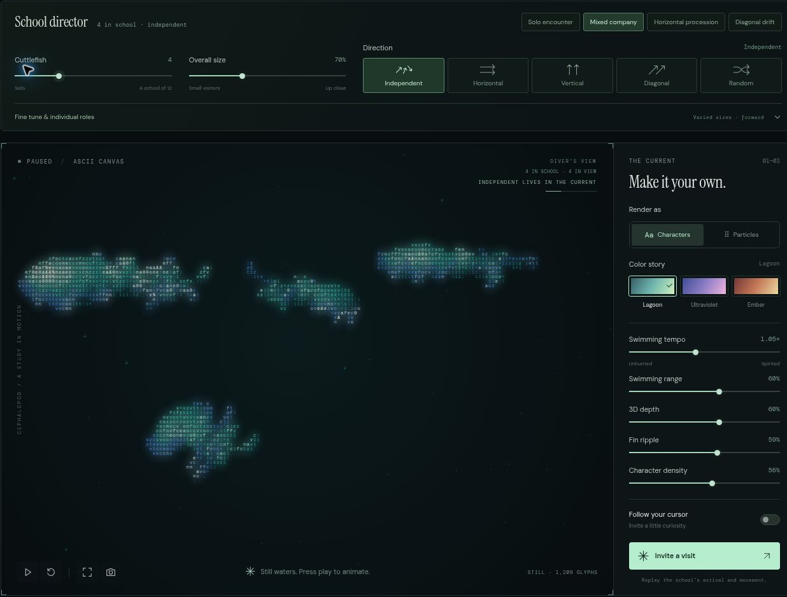

# ASCII Animals

### Cuttlefish / In the Current

An interactive cuttlefish study built from moving characters. Direct one animal or a small school, send them through the diver’s field of view, let them investigate the lens, and disturb the water to watch them react, spray black ASCII ink, and escape.

**Original procedural geometry · Canvas 2D · Perspective depth · No JavaScript dependencies**

[Open the microsite](https://cuttlefish-in-the-current.shorted-com-au.chatgpt.site/) · [Download the standalone HTML](https://github.com/castlemilk/ascii-animals/raw/refs/heads/main/dist/cuttlefish.html) · [Explore the renderer](dist/artwork.js)

The hosted microsite may require its owner’s ChatGPT sign-in. The source and standalone demo in this repository can be run locally without an account.

## A little company in the current


Choose **1–12 cuttlefish**, adjust their overall size and size variation, and give individual animals different roles. One can hover while another circles, another crosses the view, and another watches the pointer. Their fins and arms keep their own rhythms.

## Direct the school



| Direction | Performance |
| --- | --- |
| Independent | Each animal performs its assigned role. |
| Horizontal | A procession crosses from left to right. |
| Vertical | The school travels upward through the view. |
| Diagonal | The animals cross from bottom left to top right. |
| Random | Smooth individual routes explore the water. |

Reverse the shared direction, spread the animals out, mix small and large bodies, and adjust their pace. Coordinated paths take precedence over individual roles; return to **Independent** to bring those roles back.

## Come closer. Then disturb the water.



With **one cuttlefish**, **Independent** movement, and its role set to **Auto**, the three scenes perform these complete sequences:

| Scene | Behavior |
| --- | --- |
| **01 · Swim-by** | A quick entrance, a pause in the current, then a departure. |
| **02 · Close encounter** | A turn toward the diver, a centered beak, and asymmetric arms that continue reaching, curling, and crawling around the lens. A click starts its escape response. |
| **03 · Startle & ink** | Nearby repeated mouse movement builds agitation. A click on an animal also triggers its response; empty water stays quiet. |

With a school, **Auto** gives the visitors a mix of scene-appropriate roles. Close encounter sends the lead animal toward the lens while its neighbors continue their own activities; Swim-by mixes passing, hovering, circling, and curious animals. Individual role selections override those automatic assignments. A coordinated formation directs the whole school along its selected paths.

The escape is ordered: **react → spray → move away**. Ink appears as black characters carried by a directional jet, then spreads and drifts in the current. The initial warning lasts 0.34 seconds and emission takes the next 0.60 seconds; these are animation timings, not biological measurements. A deliberate **Startle cuttlefish** control provides a keyboard alternative to pointer interaction.

The GIFs above are recordings of the running renderer. They are captured through the browser’s canvas recording API and converted with FFmpeg.

## Run it

No package installation is needed.

### Open a single file

Download [dist/cuttlefish.html](dist/cuttlefish.html) and open it in a modern browser. It contains the complete artwork, controls, styles, and source viewer. The standalone file works offline with system fonts.

### Work on the source

```sh
git clone https://github.com/castlemilk/ascii-animals.git
cd ascii-animals
python3 -m http.server 8000 --directory dist
```

Open **http://localhost:8000**. Edit the files in `dist/` and refresh the page.

After changes to the page, styles, or JavaScript, rebuild the standalone version:

```sh
python3 scripts/build-standalone.py
```

The hosted page optionally uses Google Fonts, with system fallbacks. The animation itself does not fetch models, images, libraries, or external services.

## Controls



- **School direction:** population, route, size, size variation, spacing, and reverse direction. Optional labels identify individual animals as **01–12**.
- **Individual roles:** automatic, cruising, hovering, orbiting, curious, or a close encounter.
- **Art direction:** Lagoon, Ultraviolet, or Ember; ASCII characters or points; tempo, swimming range, perspective depth, fin ripple, and glyph density.
- **Interaction:** optional pointer following, per-animal clicks, agitation feedback, and deliberate startle.
- **Playback and export:** pause/resume, restart, fullscreen, PNG frame capture, actual renderer source, and a complete HTML download.

Press **Space** to pause or resume when you are not using a form control. The microsite starts paused when the browser requests reduced motion; press Play to animate. Rendering rests while the tab is hidden. All simulation and interaction run locally in the browser.

## Embed the artwork

Include the renderer and give the canvas an explicit display size:

```html
<canvas id="cuttlefish" style="width:100%;height:560px"></canvas>
<script src="artwork.js"></script>
<script>
  const artwork = new CuttlefishArtwork(
    document.getElementById('cuttlefish'),
    {
      scene: 'reactive',
      count: 5,
      formation: 'independent',
      size: 0.7,
      sizeVariation: 0.5,
      behaviors: ['hover', 'orbit', 'cruise', 'curious', 'cruise'],
      palette: 'lagoon',
      speed: 1.05,
      paused: window.matchMedia('(prefers-reduced-motion: reduce)').matches
    }
  );

  // Send the whole school upward.
  artwork.setOptions({ formation: 'vertical', reverse: false });

  // Restore each animal’s individual direction.
  artwork.setOptions({ formation: 'independent' });

  // Lifecycle and playback.
  artwork.setPaused(true);
  artwork.setPaused(false);
  artwork.restart();
  // artwork.destroy(); // Remove listeners when unmounting the canvas.
</script>
```

### School options

| Option | Values | Default |
| --- | --- | --- |
| `count` | Integer, `1`–`12` | `4` |
| `formation` | `independent`, `horizontal`, `vertical`, `diagonal`, `random` | `independent` |
| `size` | `0.35`–`1.4` | `0.7` |
| `sizeVariation` | `0`–`1` | `0.45` |
| `spacing` | `0.65`–`1.6` | `1` |
| `reverse` | Boolean | `false` |
| `showLabels` | Boolean; display the animal’s number | `false` |
| `behaviors` | Per-animal array: `auto`, `cruise`, `hover`, `orbit`, `curious`, `encounter` | Automatic roles |

Other options include `scene` (`swimby`, `encounter`, `reactive`), `palette` (`lagoon`, `ultraviolet`, `ember`), `mode` (`ascii`, `points`), `speed`, `ripple`, `density`, `motion`, `depthStrength`, `followPointer`, `glow`, and `paused`.

`getStats()` provides frame rate, rendered glyph count, phase, progress, agitation, reaction stage, population, visible population, and per-animal status. `pulse()` provides the same deliberate replay/startle action used by the microsite. `restart()` resets the performance; changing a scene or restarting preserves pause state.

## How it works

The cuttlefish is modeled with sampled parametric surfaces: a tapered mantle, rippling fins, a separate head and eyes, eight arms, two longer tentacles, and a two-jaw beak. Traveling waves deform the fins and arms. Close to the lens, each arm follows its own reach, contact, creep, and peel cycle, with curled tips and raised suction cups.

The scene uses a fixed diver’s viewpoint. World-space movement, perspective projection, banking, a fixed light, and distance haze establish volume. A depth buffer keeps the nearest surface sample in each character cell; that sample chooses the glyph, brightness, and material color. A cached glyph atlas and a small glow buffer render the luminous character field.

The school shares the rendering surface. Each animal has its own position, rhythm, size, role, and reaction state. Clicking an animal targets its visible silhouette. Its neighbors can continue swimming as it reacts and leaves.

Ink is also made from characters. A timed particle jet aims toward the disturbance, slows, curls into the current, spreads, and fades. Its density determines which black glyphs occupy the ink grid. This is a stylized underwater motion model, not a scientific fluid or anatomical simulation.

Performance depends on population, glyph density, viewport, browser, and hardware. Use the visible FPS counter to tune a scene for the device running it.

## Check the simulation

Run the dependency-free numerical checks with Node.js 18 or newer:

```sh
node scripts/check-engine.cjs
```

The checks cover population and size limits, finite projected geometry, per-animal click targeting, ordered reactions, neighboring movement, pause/reset, direction reversal, and the original lens encounter. The GIFs and responsive controls are also checked in a real browser; the numerical harness does not replace visual review.

## Record your own GIFs

With the local server running, open **http://localhost:8000/record.html**. Choose a performance and select **Record**. Keep the tab visible until it downloads its WebM file.

| Preset | Duration | Recorded direction |
| --- | --- | --- |
| Mixed company | 8 seconds | Five animals with mixed sizes and roles. |
| Four directions | 12 seconds | Horizontal, vertical, diagonal, then random, three seconds each. |
| Close encounter & ink | 12 seconds | Approach, lens exploration, then a startle seven seconds into the recording. |

Install FFmpeg separately, then convert the downloaded clips:

```sh
bash scripts/make-gifs.sh school.webm docs/gifs/school.gif
bash scripts/make-gifs.sh formations.webm docs/gifs/formations.gif
bash scripts/make-gifs.sh encounter-ink.webm docs/gifs/encounter-ink.gif
```

The script defaults to a 560-pixel-wide, 10 fps looping GIF. Optional third and fourth arguments set width and frame rate:

```sh
bash scripts/make-gifs.sh school.webm school-small.gif 480 10
```

WebM capture uses `canvas.captureStream()` and `MediaRecorder`. If those APIs are unavailable, the recording page explains the limitation; they are not required to view the artwork.

## Project layout

```text
dist/
  index.html           Microsite and accessible controls
  styles.css           Responsive layout and visual design
  artwork.js           Procedural cuttlefish renderer and simulation
  app.js               School director, interactions, and exports
  cuttlefish.html       Generated standalone offline version
  record.html           Live canvas recording utility
scripts/
  build-standalone.py   Rebuild the single-file version
  make-gifs.sh         Convert actual WebM captures to GIFs
  check-engine.cjs     Numerical simulation regression checks
docs/
  gifs/                Animation recordings used in this README
```

## Origin

This study began with a supplied luminous ASCII jellyfish video credited on screen to **@dwcminh.ascii**. It showed excerpts of a Python file, not a complete source distribution. The cuttlefish geometry, movement, interaction, renderer, and microsite here are independently implemented in JavaScript. The reference video is not included in this repository.
