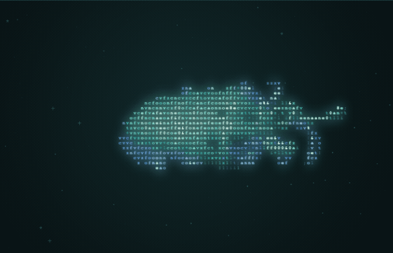
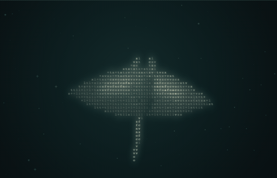
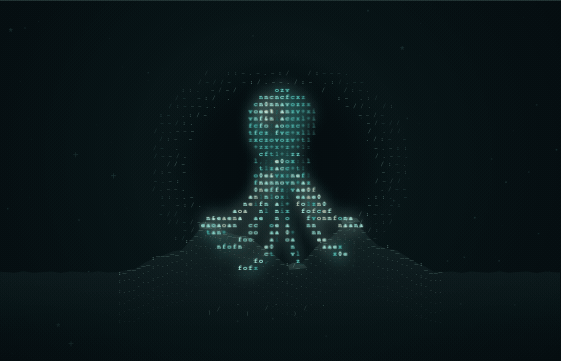
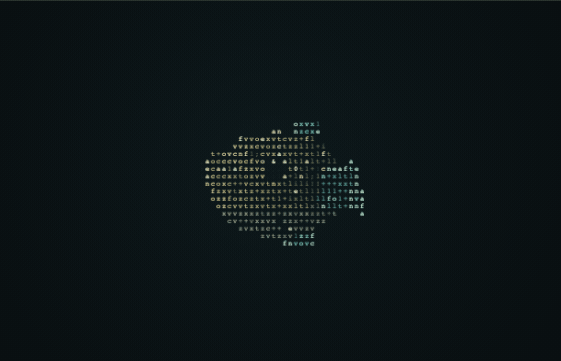
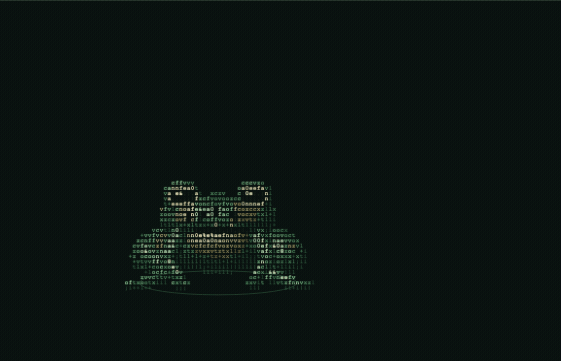
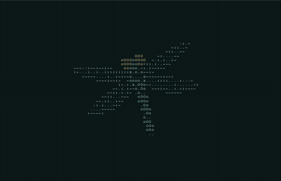
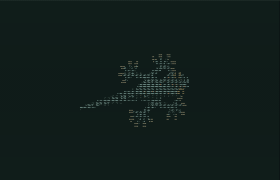

# ASCII Animals

**Thirteen creatures, drawn with moving characters.**

Interactive browser studies with procedural geometry, animated ASCII glyphs and a TypeScript library. Each animal has its own movement, habitat and reactions.

[**Live demo**](https://castlemilk.github.io/ascii-animals/) · [**Animal APIs**](docs/ANIMAL-APIS.md) · [**Local package**](package.json) · [**Quick start**](#quick-start)

**ES modules · zero runtime dependencies · explicit pause and disposal**

The package is a private local candidate: `ascii-animals-review@0.0.0-review.0`. Install the built tarball below; there is no npm release for this project. The registry package named `ascii-animals` is a different project.

## Meet the animals

Open a name or preview to explore the live study and its controls.

These are **four-second idle previews**, captured from the real browser renderers at [`bea7753`](https://github.com/castlemilk/ascii-animals/commit/bea7753bcb0c998e744effd11421b16ddeaa5bbc). They show ordinary motion, not interaction demonstrations or a recording of every later source change. [Capture method and manifest](docs/GALLERY-CAPTURES.md).

GIFs autoplay independently of reduced-motion preferences. For motion controls, use the [live demo](https://castlemilk.github.io/ascii-animals/). The thirteen previews total about **3.2 MiB**.

| **[Cuttlefish](https://castlemilk.github.io/ascii-animals/animals/cuttlefish/)** | **[Manta ray](https://castlemilk.github.io/ascii-animals/animals/manta/)** | **[Octopus](https://castlemilk.github.io/ascii-animals/animals/octopus/)** |
| --- | --- | --- |
| [](https://castlemilk.github.io/ascii-animals/animals/cuttlefish/) | [](https://castlemilk.github.io/ascii-animals/animals/manta/) | [](https://castlemilk.github.io/ascii-animals/animals/octopus/) |

| **[Seahorse](https://castlemilk.github.io/ascii-animals/animals/seahorse/)** | **[Crab](https://castlemilk.github.io/ascii-animals/animals/crab/)** | **[Sea turtle](https://castlemilk.github.io/ascii-animals/animals/turtle/)** |
| --- | --- | --- |
| [](https://castlemilk.github.io/ascii-animals/animals/seahorse/) | [](https://castlemilk.github.io/ascii-animals/animals/crab/) | [](https://castlemilk.github.io/ascii-animals/animals/turtle/) |

| **[Pufferfish](https://castlemilk.github.io/ascii-animals/animals/pufferfish/)** | **[Frog](https://castlemilk.github.io/ascii-animals/animals/frog/)** | **[Butterfly](https://castlemilk.github.io/ascii-animals/animals/butterfly/)** |
| --- | --- | --- |
| [](https://castlemilk.github.io/ascii-animals/animals/pufferfish/) | [](https://castlemilk.github.io/ascii-animals/animals/frog/) | [](https://castlemilk.github.io/ascii-animals/animals/butterfly/) |

| **[Dragonfly](https://castlemilk.github.io/ascii-animals/animals/dragonfly/)** | **[Gecko](https://castlemilk.github.io/ascii-animals/animals/gecko/)** | **[Owl](https://castlemilk.github.io/ascii-animals/animals/owl/)** |
| --- | --- | --- |
| [](https://castlemilk.github.io/ascii-animals/animals/dragonfly/) | [](https://castlemilk.github.io/ascii-animals/animals/gecko/) | [](https://castlemilk.github.io/ascii-animals/animals/owl/) |

| **[Fox](https://castlemilk.github.io/ascii-animals/animals/fox/)** |
| --- |
| [](https://castlemilk.github.io/ascii-animals/animals/fox/) |

## Quick start

Requires **Node.js 20+**, npm and Python 3. From a terminal:

```sh
git clone https://github.com/castlemilk/ascii-animals.git
cd ascii-animals
npm ci --ignore-scripts --no-audit --no-fund
npm run build
python3 -m http.server 8000 --bind 127.0.0.1
```

Open **[the local cuttlefish example](http://127.0.0.1:8000/examples/cuttlefish.html)**, then press **Play**. It starts paused and provides keyboard-accessible Play, Pause, Restart and Startle buttons, plus animal-count and route controls. Serve over HTTP; opening the module example as a `file://` URL is not the setup above.

To run the full thirteen-animal catalogue locally, follow the [demo setup](demo/README.md) (Node.js 20.9+).

## Use the local package

After building, create a tarball in the repository:

```sh
npm pack --ignore-scripts
```

In your application's directory, install that file:

```sh
npm install --offline --ignore-scripts --no-audit --no-fund \
  /absolute/path/to/ascii-animals-review-0.0.0-review.0.tgz
```

Give the artwork an explicitly sized host:

```html
<canvas id="animal" role="img"
  aria-label="Four cuttlefish drawn with moving ASCII characters"
  style="display:block;width:100%;height:360px"></canvas>
```

Then run this **client-side TypeScript module through your app's bundler**, after the canvas exists. The quick-start example above uses browser-ready modules directly.

```ts
import { createArtwork } from 'ascii-animals-review';

const canvas = document.querySelector<HTMLCanvasElement>('#animal');
if (!canvas) throw new Error('Missing #animal canvas');

const artwork = createArtwork(canvas, {
  species: 'cuttlefish',
  scene: 'reactive',
  count: 4,
  maxFps: 30,
  reducedMotion: 'system',
});

// Call artwork.dispose() when this view unmounts.
```

Omitting `paused` respects system reduced motion. Wire your own controls to `pause()`, `play()`, `restart()` and `pulse()`; an explicit `play()` overrides the initial system pause, while `pulse()` does not resume playback. Dispose the controller and remove host-owned listeners on teardown. The [runnable example](examples/cuttlefish.mjs) shows control ownership and cleanup.

`createArtwork` supports **cuttlefish, manta and octopus**. The other ten species have their own typed factories and configuration; see the [complete API map](docs/ANIMAL-APIS.md). Most draw to Canvas 2D; **Owl uses an HTML element and DOM text**. Imports are safe on the server; construct artwork only in the browser, after mounting its host. There is no bundled React adapter.

## Explore the code

| You want to… | Start here |
| --- | --- |
| Choose an animal and its import | [All animal APIs](docs/ANIMAL-APIS.md) |
| Configure marine artwork and lifecycle | [Typed API](docs/TYPESCRIPT-API.md) |
| Direct seeded travel across the viewport | [Movement API](docs/MOVEMENT.md) |
| Run or maintain the full demo | [Demo setup and deployment](demo/README.md) |
| Understand the renderer or add a host | [Architecture](docs/ARCHITECTURE.md) · [Extension guide](docs/EXTENDING.md) |
| Review captures and release checks | [Gallery captures](docs/GALLERY-CAPTURES.md) · [Release guide](docs/RELEASE.md) |

Pages is deployed manually; a change to `main` does not automatically update the live demo. Source experiments and local variants are not evidence of a deployed feature.

## Credit and licence

The original luminous ASCII jellyfish reference was credited on screen to **@dwcminh.ascii**. The cuttlefish geometry, motion, interactions, renderer and microsite were independently implemented in JavaScript. The reference video and its visible source excerpts are not included here; its licensing chain and authorship were not independently established by the import review.

The package remains **private** and **`UNLICENSED`**, with no licence grant supplied. See [NOTICE.md](NOTICE.md) for retained attribution, import provenance and release status.
