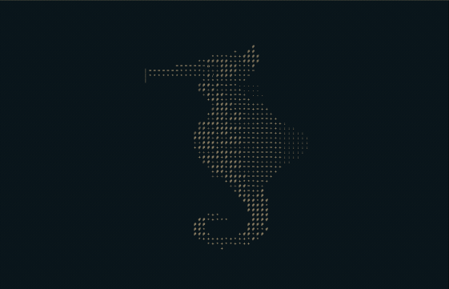
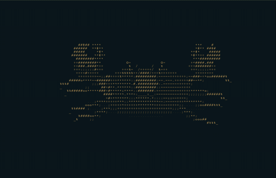
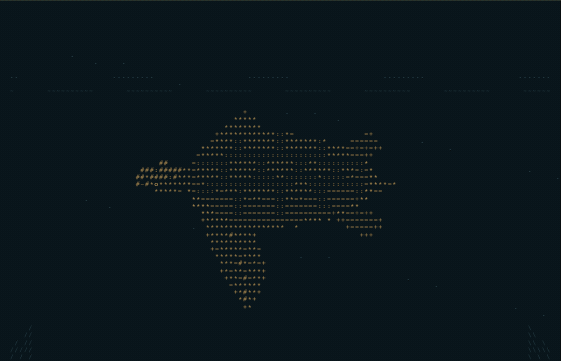
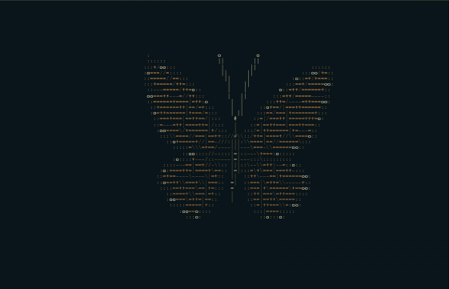
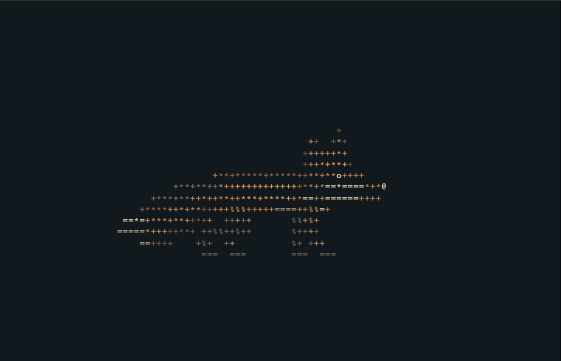

# ASCII Animals

A collection of reactive creatures drawn with moving characters. Each animal has its own study and behaviour.

[Live catalogue](https://castlemilk.github.io/ascii-animals/) · [Animal gallery](#meet-the-animals) · [Local install](#build-and-try-the-local-library-candidate) · [TypeScript API](#typescript-first-artwork-api) · [Demo design](docs/demo-shell/DESIGN.md)

## Meet the animals

Thirteen characters. Thirteen personalities. Choose a moving preview to open its interactive study, with shared navigation and playback controls.

These short loops are captured from the actual upgraded renderers, not concept art. The live studies offer pause and reduced-motion support; GIF previews loop automatically. [Capture details and reproducible workflow](docs/GALLERY-CAPTURES.md).

| **Cuttlefish** | **Manta ray** | **Octopus** |
| --- | --- | --- |
| [](https://castlemilk.github.io/ascii-animals/animals/cuttlefish/) | [](https://castlemilk.github.io/ascii-animals/animals/manta/) | [](https://castlemilk.github.io/ascii-animals/animals/octopus/) |
| [Explore Cuttlefish ↗](https://castlemilk.github.io/ascii-animals/animals/cuttlefish/) | [Explore Manta ray ↗](https://castlemilk.github.io/ascii-animals/animals/manta/) | [Explore Octopus ↗](https://castlemilk.github.io/ascii-animals/animals/octopus/) |

| **Seahorse** | **Crab** | **Sea turtle** |
| --- | --- | --- |
| [](https://castlemilk.github.io/ascii-animals/animals/seahorse/) | [](https://castlemilk.github.io/ascii-animals/animals/crab/) | [](https://castlemilk.github.io/ascii-animals/animals/turtle/) |
| [Explore Seahorse ↗](https://castlemilk.github.io/ascii-animals/animals/seahorse/) | [Explore Crab ↗](https://castlemilk.github.io/ascii-animals/animals/crab/) | [Explore Sea turtle ↗](https://castlemilk.github.io/ascii-animals/animals/turtle/) |

| **Pufferfish** | **Frog** | **Butterfly** |
| --- | --- | --- |
| [](https://castlemilk.github.io/ascii-animals/animals/pufferfish/) | [](https://castlemilk.github.io/ascii-animals/animals/frog/) | [](https://castlemilk.github.io/ascii-animals/animals/butterfly/) |
| [Explore Pufferfish ↗](https://castlemilk.github.io/ascii-animals/animals/pufferfish/) | [Explore Frog ↗](https://castlemilk.github.io/ascii-animals/animals/frog/) | [Explore Butterfly ↗](https://castlemilk.github.io/ascii-animals/animals/butterfly/) |

| **Dragonfly** | **Gecko** | **Owl** |
| --- | --- | --- |
| [](https://castlemilk.github.io/ascii-animals/animals/dragonfly/) | [](https://castlemilk.github.io/ascii-animals/animals/gecko/) | [](https://castlemilk.github.io/ascii-animals/animals/owl/) |
| [Explore Dragonfly ↗](https://castlemilk.github.io/ascii-animals/animals/dragonfly/) | [Explore Gecko ↗](https://castlemilk.github.io/ascii-animals/animals/gecko/) | [Explore Owl ↗](https://castlemilk.github.io/ascii-animals/animals/owl/) |

| **Fox** |  |  |
| --- | --- | --- |
| [](https://castlemilk.github.io/ascii-animals/animals/fox/) |  |  |
| [Explore Fox ↗](https://castlemilk.github.io/ascii-animals/animals/fox/) |  |  |

### One collection, individual experiences

The [Next.js demo](demo/README.md) consumes the built TypeScript package, with a canonical route for every species. Original studio URLs and their detailed controls remain available for compatibility. [All animal APIs and configuration guides](docs/ANIMAL-APIS.md) describe each species’ own interactions.

The original thirteen-species release and bounded visual checks are recorded in [visual acceptance](docs/VISUAL-ACCEPTANCE.md); newer renderer work builds on that baseline. Gallery captures document the current source, not a claim that every animation or device has been exhaustively tested.


## Dragonfly artwork

Use the [dedicated Dragonfly adapter](docs/DRAGONFLY-API.md) and `./dragonfly` package
subpath for hover/tracking, deliberate dart and full/slow/static motion. The
generated compatibility demo lives in `dist/dragonfly/`. [Open the Dragonfly study](https://castlemilk.github.io/ascii-animals/animals/dragonfly/).

## Fox artwork

The original reactive fox is available through a dedicated typed adapter and
[`./fox` package subpath](docs/FOX-API.md), with [a runnable demo](./dist/fox/index.html).
It preserves its own fixed-tick behavior model rather than pretending to accept
cuttlefish formations or ink controls.

## Seahorse artwork

A newly authored, original Seahorse study has a dedicated [typed API](docs/SEAHORSE-API.md)
and [local demo](dist/seahorse/index.html). It adds hovering, curiosity and a curled
holdfast pose; reduced motion and pause always remain authoritative. The study is
[live in the catalogue](https://castlemilk.github.io/ascii-animals/seahorse/index.html); bounded browser acceptance is recorded in the release evidence above.

## Crab artwork

The newly authored [Crab API](docs/CRAB-API.md) and [local demo](dist/crab/index.html)
add sideways scuttling, a broad shell, eight articulated walking legs and paired
claws with a defensive gesture. The study is [live](https://castlemilk.github.io/ascii-animals/crab/index.html), with bounded independent browser acceptance recorded in the release evidence above.

[Complete typed API map and configuration guides](docs/ANIMAL-APIS.md)

## TypeScript-first artwork API

The compiled, strict TypeScript facade exposes all currently supported cuttlefish
configuration, validates changes atomically, and keeps ownership explicit:

```ts
import { createArtwork, type ArtworkOptions } from 'ascii-animals-review';

const options = {
  species: 'cuttlefish', count: 4, formation: 'horizontal',
  behaviors: ['hover', 'orbit', 'cruise', 'curious'],
  maxFps: 30, maxDpr: 2, reducedMotion: 'system',
} satisfies ArtworkOptions;
const artwork = createArtwork(canvas, options);
artwork.update({ formation: 'vertical', reverse: true });
artwork.pause();
artwork.restart(); // preserves pause
artwork.play(); // deliberate playback overrides system-initialized pause
artwork.pulse(); // scene action, never implicitly resumes
const config = artwork.getOptions(); // immutable independent snapshot
artwork.dispose(); // call on unmount; safe to repeat
```

Use the [local tarball workflow](#build-and-try-the-local-library-candidate) to
try the package. Built-in `cuttlefish`,
`manta`, and `octopus` share one bounded marine renderer; see [species configuration and limitations](docs/SPECIES.md). Existing `CuttlefishArtwork` and
`createCuttlefish` exports remain compatible. See [the typed API](docs/TYPESCRIPT-API.md).


**Canvas 2D · zero runtime dependencies · explicit lifecycle · per-animal ESM entry · local review candidate**

## Review status and source

Current collection evidence: [all-species integration](docs/ALL-SPECIES-INTEGRATION.md) and [bounded visual acceptance](docs/VISUAL-ACCEPTANCE.md). The [original package integration review](docs/INTEGRATION-REVIEW.md) is historical and retains its then-open checks; it is not the current deployment status. The TypeScript foundation is merged.
[Open the Cuttlefish study](https://castlemilk.github.io/ascii-animals/animals/cuttlefish/) · [Original microsite](https://cuttlefish-in-the-current.shorted-com-au.chatgpt.site/) · [Download the standalone HTML](https://github.com/castlemilk/ascii-animals/raw/refs/heads/main/dist/cuttlefish.html) · [Explore the renderer](dist/artwork.js)

The original package review was based on [PR #1's import commit `7e5984d34a139b8de4643f1ed0607897a42d88dc`](https://github.com/castlemilk/ascii-animals/commit/7e5984d34a139b8de4643f1ed0607897a42d88dc), branch `feat/cuttlefish-microsite-import`. Its imported files match the inspected local site snapshot `afcce9941c5fa13ca5c658564e73388e603dff14`; local hosting metadata is excluded from the import. The original `main` read contained only `.gitignore` at `84bd1f84fab0f5f5dec053c0d10562c10be8c188`.

The accessible saved microsite version 4 points to the older source commit `6214a09171fa328beec984edd6533c33e83ce9f1`. Site metadata links it to the supplied [Cuttlefish conversation](https://chatgpt.com/c/6afd2c72-71ec-83ec-b182-835c5e7f86b1), but that original provenance review could not read the full conversation or inspect the live runtime. Later browser acceptance applies to the integrated GitHub Pages build, not that historical saved site. Do not assume the saved site, import branch, and candidate are identical.

The local package is named `ascii-animals-review@0.0.0-review.0`, with `private: true` and `license: "UNLICENSED"`. It is not published to npm. A final package name, license, browser support matrix, and broader visual/performance acceptance remain owner decisions; bounded Chrome checks do not certify creative completeness or measured performance. The microsite, recorder and standalone now use a generated browser-global build of the same canonical `src/` engine. A frozen legacy renderer remains only under `test/fixtures/` for compatibility checks.

[API guide](docs/API.md) · [Architecture](docs/ARCHITECTURE.md) · [Extension guide](docs/EXTENDING.md) · [Release checks](docs/RELEASE.md) · [Backlog drafts](docs/BACKLOG.md)

## See the existing cuttlefish

The original import modeled a tapered mantle, rippling skirt fins, raised eyes, eight arms, two longer tentacles, and a beak from a fixed diver’s view. That historical eye treatment is not the current V7.1 anatomy. The imported demo supports a school of 1–12 animals, individual roles, horizontal/vertical/diagonal/random routes, stable size variation, three palettes, glyph/point rendering, and pointer or button-triggered reactions. These GIF assets are retained from the import, whose README describes them as recordings. They are not evidence that the hardened candidate has passed new browser QA.


| Scene / direction | Behavior |
| --- | --- |
| Swim-by | The original single animal enters quickly, lingers, then leaves. |
| Close encounter | The original single animal approaches the lens and continues asymmetric arm movement during its hold. |
| Startle & ink | Eligible animals react, spray, then move away. |
| Independent school | Each animal uses its assigned or scene-derived role. |
| Horizontal / vertical / diagonal / random | The selected formation takes precedence over individual roles. |

The original solo scenes require one animal, independent formation, and the `'auto'` role. A school has different composition and role selection; increasing population does not reproduce twelve identical solo performances.

Serve the imported demo without installing dependencies:

```sh
python3 -m http.server 8000 --directory dist
```

Open `http://localhost:8000`. The standalone `dist/cuttlefish.html` opens locally without dependencies. Run `npm ci --ignore-scripts` once, then `npm run build` after source changes to generate both ESM package output and the browser-global/standalone demos from canonical `src/`. `python3 scripts/build-standalone.py` remains a compatibility command and invokes the same canonical demo generator. Run `node scripts/build-demo.mjs --check` to reject stale committed output.

## Build and try the local library candidate

Use the included source and a local tarball. Do not infer registry availability from these examples.

```sh
npm ci --ignore-scripts
npm run build
npm run check:package
npm pack --dry-run --json --ignore-scripts
npm pack --json --ignore-scripts
```

After inspecting the tarball, install that local file in a temporary consumer with scripts disabled:

```sh
npm install --offline --ignore-scripts --no-audit --no-fund \
  /absolute/path/to/ascii-animals-review-0.0.0-review.0.tgz
```

An application can import the animal entry:

```js
import { createCuttlefish } from 'ascii-animals-review/cuttlefish';

const canvas = document.querySelector('#cuttlefish');
const artwork = createCuttlefish(canvas, {
  count: 4,
  scene: 'reactive',
  formation: 'independent',
  behaviors: ['hover', 'orbit', 'cruise', 'curious'],
  size: 0.7,
  density: 1.1,
  paused: true
});

document.querySelector('#play').addEventListener('click', () => {
  artwork.setPaused(false); // Deliberate Play action.
});
document.querySelector('#pause').addEventListener('click', () => {
  artwork.setPaused(true);
});
document.querySelector('#startle').addEventListener('click', () => {
  artwork.pulse(); // Does not silently resume a paused candidate.
});

// Update an existing instance; preserve ownership of its canvas.
artwork.setOptions({ formation: 'vertical', reverse: false });

// On component/page teardown:
// artwork.destroy();
// Also remove the application's button listeners or use AbortController.
```

The matching host markup needs an explicit CSS size and an accessible description:

```html
<canvas id="cuttlefish" role="img"
  aria-label="A school of cuttlefish drawn with luminous characters"
  style="display:block;width:100%;height:480px"></canvas>
<button id="play" type="button">Play</button>
<button id="pause" type="button">Pause</button>
<button id="startle" type="button">Startle cuttlefish</button>
```

The engine does not create the application's controls. Decorative use should hide the canvas from assistive technology and avoid pointer/focus obligations. Meaningful artwork needs text explaining its behavior. The visible characters are rasterized glyphs, not selectable terminal text.

## Imports, SSR, and ownership

| Import | Contents |
| --- | --- |
| `ascii-animals-review/cuttlefish` | `CuttlefishArtwork`, `createCuttlefish`, and cuttlefish types |
| `ascii-animals-review/core` | `createScheduler` and scheduling types |
| `ascii-animals-review` | Convenience entry; see its declaration file for exports |

ESM import is designed to be safe during SSR: importing does not create canvases or access browser globals. Construct an animal only after a browser canvas exists. The candidate does not claim server-side image rendering. There is no React runtime dependency or published React adapter; [the extension guide](docs/EXTENDING.md) includes an explicit draft integration example.

TypeScript root/animal consumers need the `DOM` library for `HTMLCanvasElement`.
The `./core` declarations also work in a DOM-free TypeScript project.

Eligible automatic instances share a per-window scheduler. Paused, hidden, offscreen, zero-sized, and destroyed instances contribute no automatic frames. `destroy()` is idempotent and removes owned work; host controls and polling remain the host's responsibility. The candidate follows reduced motion by default. An explicitly supplied `paused: false` or a later `setPaused(false)` is deliberate playback intent; choose it with care in host code.

The package includes explicit resource limits: default DPR ceiling 2, main-canvas backing-store ceiling 8,294,400 pixels, per-grid ceiling 65,536 cells, and automatic cadence ceiling 60 fps (configurable from 10 to 120). Glyph atlas resolution is bounded separately. These are individual bounds and requested cadence, not a total-memory bound or a promise of 60 fps on every device. Effective quality can be lower on oversized canvases. See [API.md](docs/API.md) for the full option contract and compatibility changes.

## Controlled stepping

For numerical tests or a controlled browser capture, create with `autoStart: false` and call `advance(dtSeconds)` with a finite duration from 0 to 0.1 seconds:

```js
const artwork = createCuttlefish(canvas, { autoStart: false, paused: true });
artwork.restart();
for (let frame = 0; frame < 120; frame++) artwork.advance(1 / 60);
```

An explicit manual step advances while paused. It is not an arbitrary-time seek operation. Repeatability requires the same options, viewport, input sequence, and step sequence. Pixels may differ across browser fonts and rasterizers, and ink integration is not promised to be independent of frame partition.

## Performance and validation

The existing renderer already reuses a geometry buffer, depth-buffer arrays, cached glyph atlases, and grid-sized glow surfaces. The candidate concentrates on lifecycle, bounded resources, packaging, and repeatable measurements. No GPU renderer rewrite is required for this stage.

The imported numerical check remains available:

```sh
node scripts/check-engine.cjs
```

That test uses a stubbed Canvas context. It checks numerical/behavioral conditions; it does not establish visual correctness, real Canvas speed, browser compatibility, or accessibility. The review's verification log records tests actually run, source hashes, fixture/bundler versions, benchmark samples, and acceptance still open. Proposed budgets and calculated memory capacities are labeled separately from measurements. The release guide contains the complete consumer and browser matrix.

## Project layout

| Path | Purpose |
| --- | --- |
| `src/animals/cuttlefish.js` | Candidate ESM implementation derived from imported renderer |
| `src/core/` | Injectable shared scheduling support |
| `types/` | Public declarations, mirrored into the built package |
| `lib/` | Generated package files |
| `fixtures/` | Package consumer, bundler, and type-check inputs |
| `dist/` | Animal catalogue, hosted Cuttlefish study, generated canonical browser engine and standalone demo |
| `scripts/` | Build, package checks, original numerical checks, standalone/GIF utilities |
| `docs/` | API, architecture, extension, release, source references, and backlog drafts |

## Origin and license status

The imported README describes the geometry, motion, renderer, and microsite as original procedural JavaScript inspired by a supplied luminous ASCII jellyfish reference. This review inspected code and provenance metadata, not the original video's licensing chain, and did not copy code or artwork from that video. No LICENSE was present in the inspected import. The candidate retains source attribution and stays `UNLICENSED` until the owner chooses and supplies an appropriate license. No external animal assets, models, or runtime libraries have been introduced.
This study began with a supplied luminous ASCII jellyfish video credited on screen to **@dwcminh.ascii**. It showed excerpts of a Python file, not a complete source distribution. The cuttlefish geometry, movement, interaction, renderer, and microsite here are independently implemented in JavaScript. The reference video is not included in this repository.

## Deploy the public demo

[GitHub Pages demo](https://castlemilk.github.io/ascii-animals/) is deployed **manually**, not on pushes or pull requests. In GitHub Actions, choose **Deploy demo to GitHub Pages** → **Run workflow** on `main`. The workflow validates the standalone artifact and builds the unified static demo, then publishes `demo/out/`. Repository research, README recordings and source history are not part of the web deployment. The GitHub Actions environment links to the exact deployment.

Updating `main` does not update the live demo until a maintainer deliberately runs the deployment workflow. No npm publication is involved.

### Gecko

The original reactive Gecko is available through the typed `createGeckoArtwork` named export and `ascii-animals-review/gecko`. Its dedicated [API guide](docs/GECKO-API.md) documents fixed-tick gait, guide/startle/curl behavior and lifecycle. The generated demo is `dist/gecko/index.html`; the [catalogue](https://castlemilk.github.io/ascii-animals/) links the deployed study.
### Pufferfish adapter

`createPufferfishArtwork` and `ascii-animals-review/pufferfish` expose the independently configured fixed-tick pufferfish model, staged inflation and deliberate static poses. See [Pufferfish API and provenance](docs/PUFFERFISH-API.md). Local generated demo: `dist/pufferfish/index.html`. The study is [live](https://castlemilk.github.io/ascii-animals/pufferfish/index.html) with bounded browser acceptance recorded above.
## Frog adapter

The strict [`./frog` API](docs/FROG-API.md) provides a deliberate fixed-tick leap study with shared scheduling, validated settings and reduced-motion static poses. Its generated demo lives at `dist/frog/`; the [catalogue](https://castlemilk.github.io/ascii-animals/) links the deployed study.
## Owl TypeScript artwork

The explicit `createOwlArtwork(element, options)` factory is available from `ascii-animals-review/owl` in the local package. It preserves the original perched owl's bounded attention, blink/ruffle/wing response and static reduced-motion alternatives, using the shared browser scheduler. See [API and integration evidence](docs/OWL-API.md); the generated HTTP demo is `dist/owl/`. The study is deployed and has the bounded browser acceptance recorded above.

### Optional authored marine studies

The catalogue retains each original marine demo and adds opt-in studies:
[Manta reef glide](dist/manta-reef.html), [Cuttlefish field study](dist/cuttlefish-study.html),
and [Octopus dim den](dist/octopus-den.html). These share the canonical marine renderer;
they do not replace the stable package factories or claim new public exports.
The manta supports directed left/right banks, current and representative stills;
the cuttlefish study adds authored sequences while keeping the accepted V7.1 anatomy.
Keyboard controls, pause and representative reduced-motion states are covered by
numerical/mock-host tests; fresh real-browser acceptance is still pending.

`npm run build` regenerates all three previews, `npm test` includes their study
and publication suites, and `npm run typecheck` includes manta/cuttlefish study
fixtures. See [marine integration provenance and exact preservation gates](docs/MANTA-PR30-31-INTEGRATION.md).
