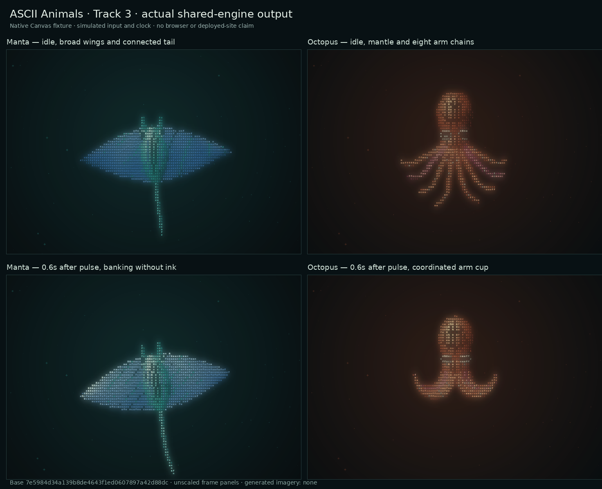

# Manta ray and octopus integration review

## Supported configuration

The typed `createArtwork` facade and compatibility renderer now support three built-in species: `cuttlefish`, `manta`, and `octopus`. There is no arbitrary species-registration or plugin API in this change. Geometry modules have no DOM, timer or browser-global side effects; the existing canonical engine owns scheduling, input, raster buffers and resource limits.

```ts
import { createArtwork, type ArtworkOptions } from 'ascii-animals-review';

const config = {
  species: 'manta',
  count: 3,
  speciesByAnimal: ['manta', 'octopus', 'cuttlefish'],
  seed: 17,
  scene: 'reactive',
  behaviors: ['hover', 'hover', 'curious'],
  density: 1.2,
  size: 0.75,
} satisfies ArtworkOptions;
const artwork = createArtwork(canvas, config);
artwork.update({ species: 'octopus', speciesByAnimal: [], count: 1 });
artwork.pause();
artwork.pulse(); // Does not resume playback.
artwork.dispose();
```

`speciesByAnimal` is an immutable snapshot array of up to 12 supported species; missing entries fall back to `species`. An empty array clears overrides. `seed` is a finite integer from 0 through 4294967295 and selects stable module variation. Changing species or seed rebuilds relevant geometry state and clears stale ink; playback pause is preserved. Other lifecycle, rendering and layout options retain their established behavior. Unknown species and invalid typed-facade values are rejected atomically. Per-animal stats include `species`; the artwork's `species` getter reflects its current school default.

The manta has broad wings, cephalic lobes and a trailing tail. It banks and escapes without emitting ink. The octopus has a mantle and eight articulated arm chains; it reaches, gathers into a cup and retreats with ink. These are original stylized procedural animals, not biological simulations.

## Demo and build

Serve `dist/` and open `animals.html`. It supports all three animals and mixed company without modifying the catalogue landing page. `animals-standalone.html` contains the same canonical renderer and controls. `npm run build` regenerates both animal and original cuttlefish artifacts. `node scripts/build-demo.mjs --check` fails if any committed generated output differs.

The original Track 3 proposal patched the old browser renderer directly. This integration deliberately did **not** apply that patch: only geometry, pose/reaction dispatch, dedicated controls and bounded configuration were ported into canonical `src/`. Its older RAF lifecycle, resource caps and registry proposal did not replace the accepted scheduler or typed public API.

## Evidence and limitations

Original research: https://chatgpt.com/c/6afd5a66-c224-83ec-a8e9-fd113a923f48

The images below are original Track 3 **native-Canvas fixture output on the old import-based proposal**, not browser screenshots or new-build performance measurements:



- [Manta native fixture animation](https://raw.githubusercontent.com/castlemilk/ascii-animals/238015d3ff08bfbb815b14b95345b2543c9ebb09/docs/species-reference/ascii-manta-runtime.gif)
- [Octopus native fixture animation](https://raw.githubusercontent.com/castlemilk/ascii-animals/238015d3ff08bfbb815b14b95345b2543c9ebb09/docs/species-reference/ascii-octopus-runtime.gif)

Independently rerun integration checks include geometry bounds/finite samples, LOD, eight fixed-length octopus chains and joint limits, repeated deterministic draw, canonical cuttlefish buffer parity, module/global parity, mixed formations, species-specific ink behavior, atomic typed updates, disposal and package consumers. These checks use Canvas stubs and are not browser FPS, GPU, touch or heap measurements.

At approximately 44×25 character cells, eight octopus chains exist numerically but are **not guaranteed to be separately readable**. Prefer density around 1.2 and review the actual viewport; no numerical topology test proves silhouette legibility. Native research described 169 rendered frames, but they were not all regenerated during this integration.

No npm publication, production deployment or merge is included in this review branch. Independent Chrome acceptance on canonical source SHA-256 `607a3814f6407501be3e650506de3eeb4fd82d6f4267dffb19c4bb09d4c07f80` confirmed distinct manta/octopus silhouettes, mixed three-species diagonal scenes, pause-safe React and Reset, reduced-motion startup, mobile 390×844 layout, pointer interaction and the HTTP standalone dark theme, with no observed console errors. The octopus gathering response was visible; the narrow ink-emission window was not captured in that initial browser review. Numerical renderer tests separately verify ink particles and rendered ink glyphs for octopus and zero for manta. Neither eight separately readable arms at low resolution nor a complete visual manta no-ink invariant is claimed. File-protocol offline execution and browser performance measurements were not run.

## Package-size tradeoff

The historical `./cuttlefish` compatibility entry now includes the two related marine geometry definitions so that the same renderer supports mixed depth-buffer scenes. It is not per-species tree-shaken. With the same esbuild 0.28.2 animal fixture, the preceding TypeScript candidate measured 48,189 minified / 17,881 gzip bytes; this integration measures 62,011 minified / 23,616 gzip bytes (an increase of 13,822 / 5,735 bytes). Core-only remains 884 minified / 476 gzip bytes and excludes animal modules. These are bundler-output sizes, not browser performance measurements. A future explicit lazy-species host split can reduce single-species transfer cost; no such isolation is claimed here.
