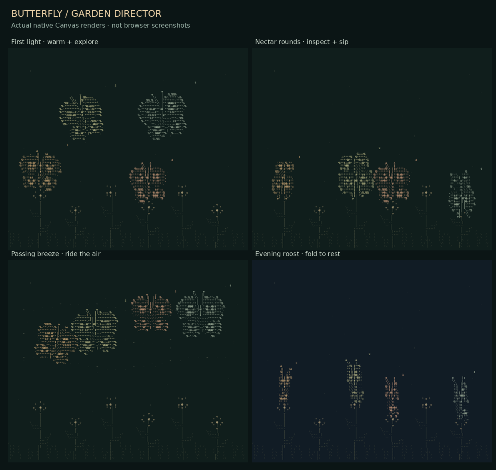

# Garden director visual evidence

These are actual pixel renders from `createButterflyArtwork` using the installed `@napi-rs/canvas` native Canvas implementation and the repository’s numerical lifecycle host. They are **not browser screenshots** and do not validate CSS, touch hardware, screen readers, or performance. The four panels show First light (act 1), Nectar rounds (act 3), Passing breeze (act 2), and Evening roost (act 4).

Reproduce the source frames after `npm run build` with `node species/butterfly/tests/render-native.mjs` in an environment with `@napi-rs/canvas` installed. `BUTTERFLY_CANVAS_MODULE` may point to an existing module. The handoff also includes the 19 full-size frames, a sampled 18-second scene animation, the renderer manifest and raw test logs.

The actual browser harness is `species/butterfly/tests/browser-check.mjs`. It remains unrun here because normal Chromium startup was denied a required socket. Physical-phone and accessibility acceptance remain open.
