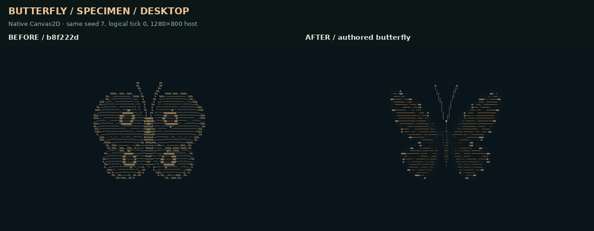
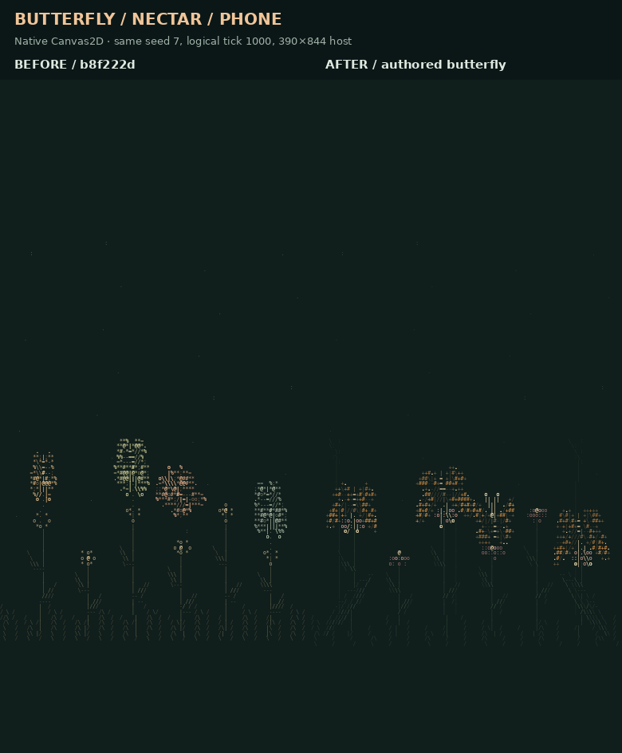
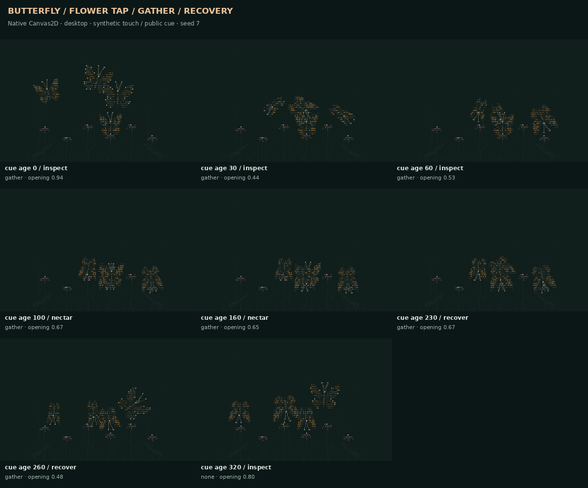
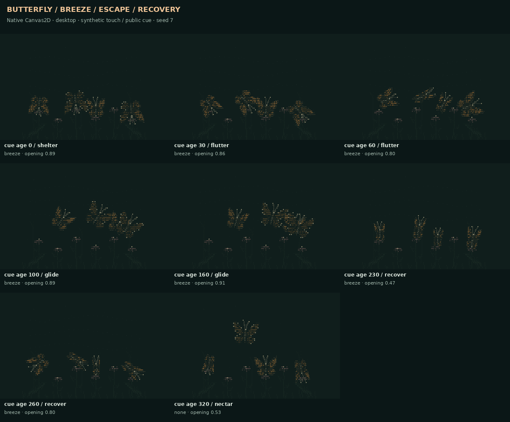
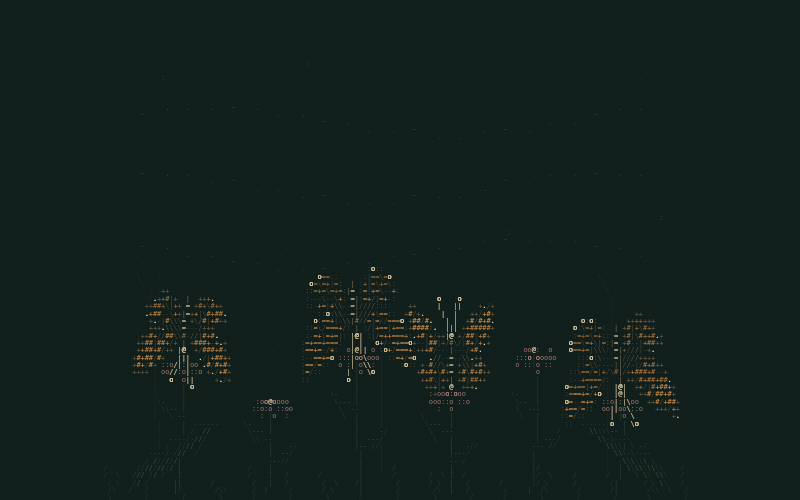

# Butterfly flight study — review

Base: `b8f222dab868821f27bf2a64a98434f3483fc8e6`.

## What changed

The default close study and garden share original monarch-inspired wing outlines,
branching vein cells, amber scale fields and pale marginal spots. A narrow body
and attached clubbed antennae stay readable through turning and folding. The
habitat uses quiet seed heads, focal flowers and a sparse foreground leaf margin.

A flower visit now banks and brakes, aligns before contact, feeds through a short
reach-limited proboscis, fans its wings with the root held, then lifts into a glide.
The disturbance cue braces for 24 ticks, escapes under powered flight, glides,
shelters and recovers within its existing 300-tick lifetime. Powered beats have
one faint edge echo; pause/reduced-motion frames clear that echo without changing
tick or pose.

A tap near a flower chooses a physical visit; an open-air tap preserves the
invitation behavior. The nectar button selects a flower without leaving a
synthetic hover target. Existing pointer modes, keyboard keys, completed touch
release, cue interruption and still tableaux remain available. Public types,
option defaults, the legacy response phases and cue strings remain compatible.

## Executed validation

| Check | Result |
| --- | --- |
| Full `npm test` on final source | 627/627 passed, zero failures/skips |
| New Butterfly behavior checks | 9 passed |
| Full `npm run typecheck` | Passed |
| Butterfly strict type fixture | Passed |
| `npm run check:package` | Passed tarball, consumer, SSR and typing checks |
| esbuild / Rollup / Webpack extras | Not run |
| Matched native render captures | 1280×800 and 390×844, same seed/options/ticks |
| Motion evidence | 32-second nectar cycle and 6-second gather/breeze clips |
| Real browser | Blocked before any successful candidate browser capture |

All runtime tests and captures used the exact source hashes in `manifest.json`.
Full builds ran in an isolated validation copy. No generated/shared output enters
this source patch. The default landing implementation initially exposed a roost
loop jump; a 0.07 normalized per-tick bound fixes the unchanged continuity gate.
Independent visual review also prompted brighter veins/body and coarser glyphs
at phone size. A review-found synthetic-hover recovery defect was fixed and has
its own regression test.

## Visual evidence and limits

These images are **native @napi-rs/canvas renders through the exact public
controller with a synthetic browser host**. They are not browser screenshots.
The real local Chromium attempt failed at startup with `socket() failed:
Operation not permitted`; the cloud browser returned `ERR_CONNECTION_REFUSED`
for the running local review server. CSS, real keyboard/touch, screen-reader,
physical-device performance and long-session heap acceptance remain open.

The four-member phone garden is silhouette-led; the specimen shows fine veins
most clearly. Motion is simulated at 60 integer ticks per second and sampled at
12 fps for evidence. Encoding cadence is not a browser performance result.











## Central integration

```sh
git apply --check butterfly-flight-study.patch
git apply butterfly-flight-study.patch
npm ci --ignore-scripts
npm run build
node --test test/butterfly.test.mjs test/butterfly-director.test.mjs test/butterfly-flight-study.test.mjs
node node_modules/typescript/bin/tsc -p species/butterfly/tests/tsconfig.json
npm run typecheck
npm run check:package
```

The existing build already copies every Butterfly runtime file. No build-list,
shared engine, package export, workflow, merge, or deployment change is required
from this branch. Central integration owns regenerated `lib/` and `dist/` output.
See `AUTHORING.md` for the pre-code brief and observational reference ledger.
