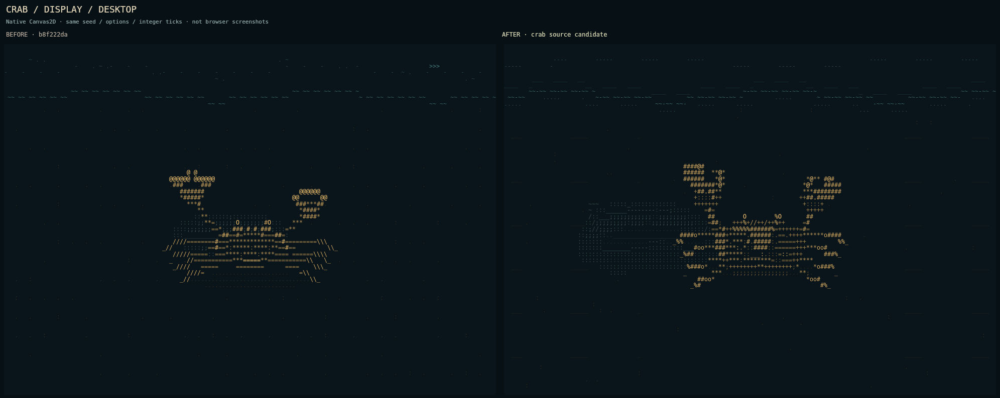
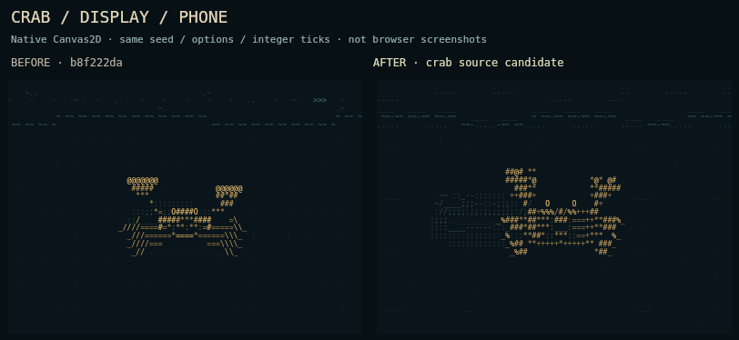
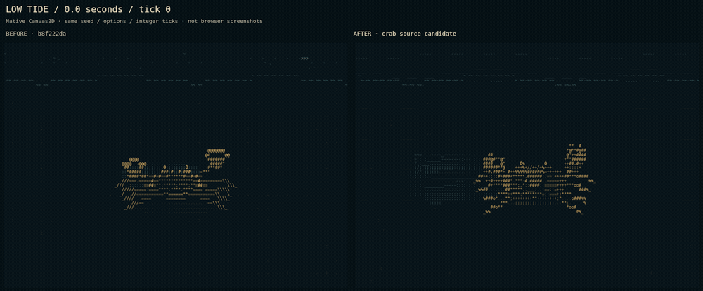
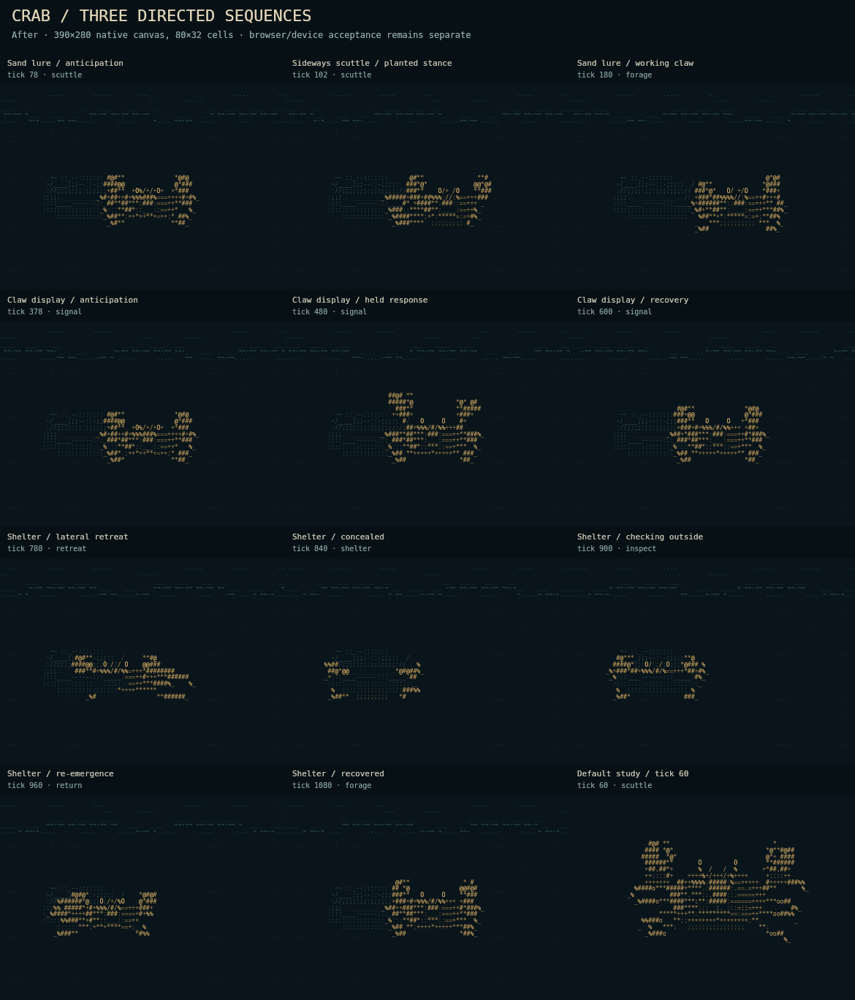

# Crab tidal-flat review

Pinned base: `b8f222dab868821f27bf2a64a98434f3483fc8e6`.
Source SHA-256: `381cf8c9018e7deceacdc82aef891857d05d46b0943187f6a92c4b7ba7bad2a2`.

The [compact manifest](review-manifest.json) records the exact source, commands,
results, capture backend, input timeline and remaining browser checks. The
downloadable review bundle also includes all 64 PNG/text fixtures, full state/hash
manifest, MP4/GIF exports, logs and the independently applicable binary patch.

## Matched captures

These are **native Canvas2D renders with a mocked lifecycle window**, not browser
screenshots. Before and after use the same seed, options, input events and logical
ticks. The font is installed DejaVu Sans Mono registered as `ui-monospace`.

Desktop canvas: 980 × 700 pixels, 140 × 56 character cells.



Phone-sized canvas: 390 × 280 pixels, 80 × 32 character cells. This checks the
artwork's minimum grid, not a full mobile page or physical phone.



## Directed motion

The export covers 18 simulated seconds / 1,080 logical ticks. It samples 181 paired
frames at 10 Hz. This is an export cadence, **not a measured runtime frame rate**.



Representative sequence states include anticipation, planted travel, a working
claw, display preparation/hold/recovery, retreat, concealment, inspection,
re-emergence and settled recovery.



Raw stills, contact frames and successive emergence frames were inspected. No
real-time browser playback was observed. Local Chromium failed before page
creation with a socket permission error; the dedicated cloud browser could not
reach the local preview. No browser or security-policy workaround was attempted.

## Reproduce and integrate

Apply the patch to the pinned base, or review this branch's commit. The patch does
not include generated `dist` or `lib` outputs. Bear can regenerate them centrally:

```sh
git apply --check crab-tidal-flat.patch
git apply crab-tidal-flat.patch
npm ci
npm run build
node --test test/crab.test.mjs test/crab-director.test.mjs test/crab-tidal-flat.test.mjs
node node_modules/typescript/bin/tsc -p species/crab/tests/tsconfig.json
npm run typecheck
npm run check:package
```

Skip the two `git apply` commands when reviewing the branch itself. The full
aggregate selection passed with bounded concurrency:

```sh
node --test --test-concurrency=1 test/*.test.mjs species/fox/tests/*.test.mjs species/dragonfly/tests/*.test.mjs species/gecko/test/*.test.mjs species/pufferfish/tests/*.test.mjs species/frog/tests/core.test.mjs species/frog/tests/geometry.test.mjs species/frog/tests/lifecycle.test.mjs species/frog/tests/demo.test.mjs species/owl/tests/*.test.mjs
```

For capture reproduction, create a separate checkout of the pinned base and run
its `npm ci` and `npm run build`. In that baseline checkout, create the manifest:

```sh
python3 - <<'PY'
import hashlib, json
from pathlib import Path
source = Path('src/public/crab.ts').read_bytes()
Path('baseline-manifest.json').write_text(json.dumps({
    'commit': 'b8f222dab868821f27bf2a64a98434f3483fc8e6',
    'files': {'src/public/crab.ts': hashlib.sha256(source).hexdigest()}
}) + '\n')
PY
```

The capture harness needs `@napi-rs/canvas@0.1.100`, `ffmpeg`, and an installed
monospace font. These are evidence tools, not new runtime dependencies. Point
`CRAB_EVIDENCE_FONT` at a font if the recorded DejaVu path is unavailable. With the
candidate built, run from its root:

```sh
node species/crab/tests/capture-review.mjs /absolute/path/to/baseline artifacts/crab-uplift
```

Use `--stills-only` to omit motion exports. Pixel hashes depend on the recorded
native backend/font. The full manifest separately records logical ASCII and cell
hashes. Real browser DOM/CSS, delivered touch/keyboard events, screen readers and
device performance remain a central acceptance gate.
