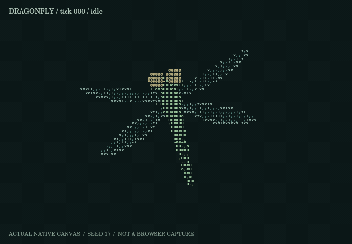
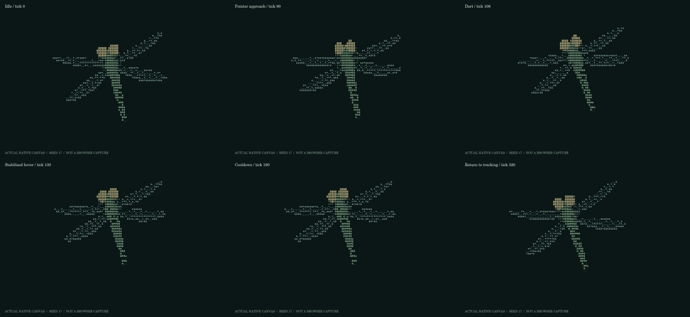

# Dragonfly — a moment in the reeds

An original **TypeScript-first reactive ASCII dragonfly** with a long segmented abdomen, two large eyes, four independently phased attached wings, pointer-guided hover and a deliberate short dart into stabilized hover.

**Draft species integration.** All implementation and evidence are local to this directory. Main has no public species hook; the small preview is replaceable when the coordinator accepts a shared renderer. [Exact compatibility and base](INTEGRATION.md) · [Typed API/defaults/validation](API.md) · [Authoring record](AUTHORING.md) · [Validation and critique](VALIDATION.md)



This is an actual **native Canvas** recording of the supplied deterministic event fixture, using the same geometry, character cells and painter as the preview. It is not a browser or deployment capture. The six-second clip repeats the fixture from its beginning; the replay reset at the GIF boundary is intentional. It is not advertised as a seamlessly looping movie.

## Try the local interactive specimen

From the repository root:

```sh
python3 -m http.server 8000 --bind 127.0.0.1
```

Open **http://127.0.0.1:8000/species/dragonfly/**. Generated ESM is committed, so viewing the specimen needs no npm installation. Serve the page over HTTP; direct `file:` ES-module loading is not a verified route.

Move your pointer or tap to guide the hover. **Invite a dart** starts one short translation, stabilization, then cooldown. Repeated dart requests during the response are ignored. Use **Pause**, **Reset**, **Slow** or **Still** at any time. Under reduced-motion preference, the specimen stays static and the action changes a single pose.

Keyboard users can Tab through native controls, use Guide to steer, and activate buttons with Enter/Space. The focused canvas also accepts arrows and Space. Touch controls need no hover or repeated gestures; scrolling remains enabled. Hidden, offscreen and zero-sized specimens suspend scheduled work.

## Use the typed model

```ts
import { createDragonfly, type DragonflyInput } from './species/dragonfly/lib/index.js';

const animal = createDragonfly({ seed: 17, motion: 'slow', wingAmplitude: 0.2 });
const inputs: DragonflyInput[] = [{ type: 'pointer', tick: 1, seq: 0, x: 0.6, y: -0.2 }];
animal.step(1, inputs);
const geometry = animal.sample();
animal.setPaused(true);
animal.configure({ trackingSpeed: 0.2 });
animal.reset(); // Keeps config and pause.
animal.dispose();
```

Browser mounting is a separate, SSR-safe import:

```ts
import { mountDragonfly } from './species/dragonfly/lib/browser.js';

const controller = mountDragonfly(canvas, {
  model: { seed: 17, motion: 'slow' },
  view: 'oblique',
});
controller.setTarget(0.5, -0.2);
controller.dart();
controller.setPaused(true);
controller.reset();
controller.dispose();
```

The browser controller exposes frozen `getState()`/`getOptions()` snapshots, status, controlled configuration and disposal. It does not expose its mutable owned model. It uses no shared global scheduler or external service. `examples/typed-model.ts` and the declaration consumer tests are executable type-check fixtures.

## Build and check

Node 24.22.1 and TypeScript 5.9.3 were used for the recorded checks. Runtime code has zero package dependencies. To rebuild, install the species-local pinned TypeScript development dependency, or point `DRAGONFLY_TSC` to an existing `typescript/lib/tsc.js`.

```sh
# From the species folder, when TypeScript 5.9.3 is already available:
node scripts/build.mjs
node scripts/build.mjs --check
node --test tests/*.test.mjs

# From the repository root, also checks the original cuttlefish and standalone:
node species/dragonfly/scripts/check.mjs
```

The type check uses strict mode, exact optional properties and unchecked-index protection. It imports the generated declarations and contains positive examples plus 14 intentional negative assertions. [Raw executed logs](evidence/checks.json) distinguish numerical/type/mock checks from raster evidence.

## Reproduce native frames

With an existing `@napi-rs/canvas` module, set `DRAGONFLY_CANVAS` to its directory if it is not locally resolvable:

```sh
node species/dragonfly/scripts/render-evidence.mjs /tmp/dragonfly-render
ffmpeg -framerate 15 -i /tmp/dragonfly-render/animation-frames/frame-%03d.png \
  -filter_complex '[0:v]split[a][b];[a]palettegen=stats_mode=diff[p];[b][p]paletteuse=dither=bayer:bayer_scale=3' \
  -loop 0 /tmp/dragonfly-render/dragonfly.gif
```

This renders explicit simulation ticks, rather than synthesizing conceptual images. It also produces the actual state hashes, contact sheet, smallest-grid poster and text specimen. The code does not bundle font files; system fonts vary across machines.



## Browser acceptance status

The installed Chromium process failed before any page opened (`socket() failed: Operation not permitted`; `ptrace: Operation not permitted`). The optional runner is ready for a supported environment:

```sh
# Start the local server above first. Use installed Playwright/Chromium:
node species/dragonfly/scripts/browser-smoke.mjs
```

`DRAGONFLY_PLAYWRIGHT_MODULE` and `DRAGONFLY_CHROMIUM` can identify existing installations. The runner records failure/blocked status explicitly and captures screenshots only after real execution. It does not substitute stubs for browser claims. Real browser behavior, phone/touch hardware, screen readers, browser performance and long-session heap acceptance remain unrun here.

No other species, root documentation, shared engine, package export, npm release or deployment is changed. The manual Pages workflow publishes only `dist/`; this separate preview is not automatically live.
