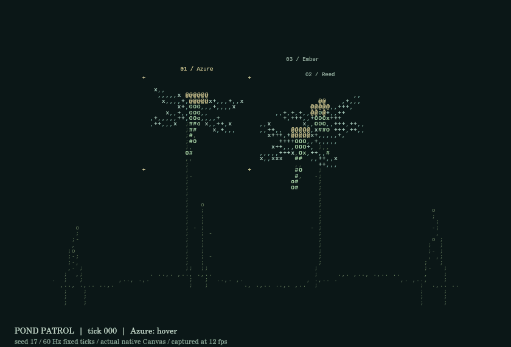
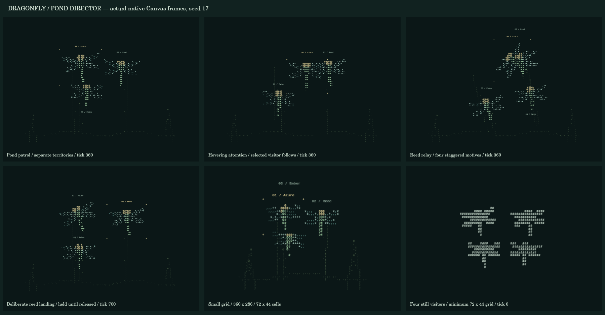

# Dragonfly — the pond director

Original procedural ASCII dragonflies with paired large eyes, a long segmented
abdomen and four narrow, attached, independently phased wings. This extension
adds a small directed pond around the existing integrated TypeScript model.

The accepted `createDragonflyArtwork` adapter and `./dragonfly` package entry are
already part of main. The new director is **pending integration review** on
`feat/director-dragonfly`, based on `c06114404900884814bef879a02f1a49a3e7d590`.
It changes only Dragonfly-owned source, generated demo/runtime, tests and docs.
The public wrapper continues to borrow the canonical per-window scheduler.

[Director API/defaults/validation](DIRECTOR-API.md) · [Pre-code brief and scene matrix](DIRECTOR.md) · [Actual evidence and remaining gates](DIRECTOR-VALIDATION.md) · [Integrated adapter](../../docs/DRAGONFLY-API.md)



This GIF contains 193 actual native Canvas frames at 12 fps, sampled from explicit
60 Hz simulation ticks 0–960. It uses the same procedural geometry, projection,
glyph compositor and painter as the demo. The replay resets at the GIF boundary;
it is not a browser recording or a seamless-loop claim.

## Direct the pond

- **Pond patrol:** separate territories, lookout pauses, landings and takeoffs.
- **Hovering attention:** one visitor attends the guide while others keep their
  own motives near the reeds.
- **Reed relay:** staggered short crossings, route following and rests.
- Choose 1–4 visitors, select by name, and assign patroller/sentinel/skimmer/wanderer
  roles. Route, tempo, spacing, size and breeze shape the composition.
- **Dart & return** sends the selected visitor on a deliberate short excursion,
  stabilizes, then returns. **Land on a reed** holds a perch; **Resume route**
  releases it. Pointer movement guides attention without triggering darts.

The demo provides keyboard/touch alternatives: native selectors and buttons,
Guide, Pause/Reset, Slow/Still, and canvas-scoped 1–4/arrow/Space shortcuts.
Reduced motion remains still; an explicit action changes the composed pose.
Hidden/offscreen/zero-size hosts suspend work. There is one canvas/subscription
per ensemble, not one animation callback per visitor.

## Preview and reproduce

The generated public-adapter demo is `dist/dragonfly/index.html`. From the repo root:

```sh
python3 -m http.server 8000 --bind 127.0.0.1 --directory dist
# Open http://127.0.0.1:8000/dragonfly/
```

The species-local source study at `species/dragonfly/index.html` can also be served
from the repository root. It uses the same compiled species host; the integrated
`dist` demo additionally uses the accepted public adapter/shared scheduler.

With TypeScript 5.9.3 available:

```sh
node scripts/build.mjs
node --test species/dragonfly/tests/*.test.mjs test/dragonfly-integration.test.mjs
node species/dragonfly/scripts/build.mjs --check
npm run typecheck
```

The generated ESM and declarations are committed. Runtime code requires no npm
runtime dependencies. The package remains private and unpublished.

To reproduce native evidence, use an already installed `@napi-rs/canvas` and ffmpeg:

```sh
# Optional: DRAGONFLY_CANVAS_MODULE=/absolute/path/to/@napi-rs/canvas/index.js
node species/dragonfly/scripts/capture-director.mjs /tmp/dragonfly-director-evidence
```

The capture program records the exact seed, tick/event sequence, source digests,
positions, phases, clipping and label counts. It exports PNG/text posters,
scene/motion contact sheets and an actual GIF. No font files or copied ASCII art
are bundled; installed system monospace fonts may differ between platforms.



## Evidence boundary and original provenance

Numerical, type, instrumented host and offline package checks are recorded in
[DIRECTOR-VALIDATION.md](DIRECTOR-VALIDATION.md). Native Canvas frames have been
critiqued and corrected. The live baseline was inspected in Chrome; this new local
demo was not browser-tested because the cloud browser could not reach the local
server. Browser layout/input, real touch, screen readers, measured browser
performance and deployment acceptance remain unrun for this extension.

The original anatomy/geometry/font-rights provenance remains in
[AUTHORING.md](AUTHORING.md) and `authoring.json`. The original solo
[API](API.md), [validation record](VALIDATION.md) and [integration proposal](INTEGRATION.md)
are retained as historical records of the initial species delivery. They do not
supersede the accepted current package adapter or this additive director API.
No educational ray renderer, external ASCII artwork, third-party mesh or font
binary was copied into the director.
