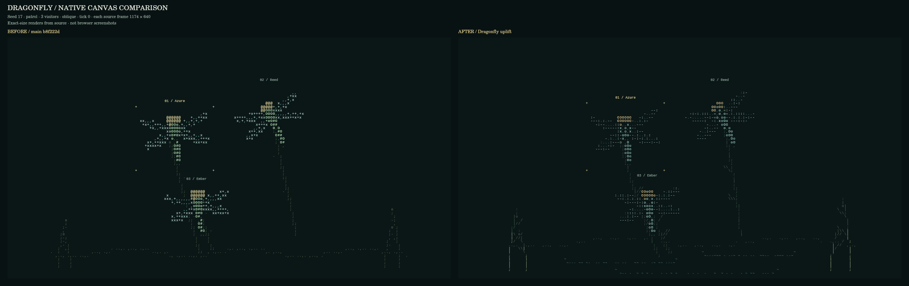
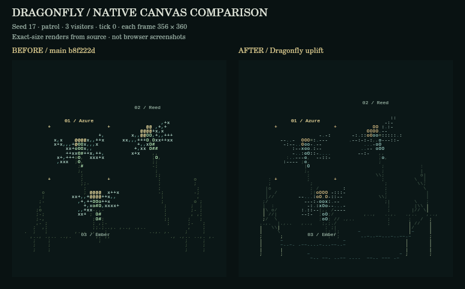
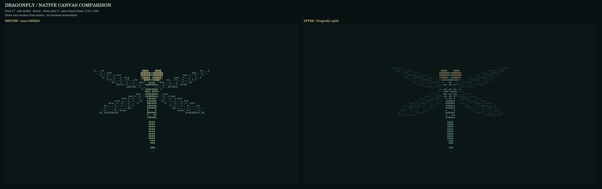
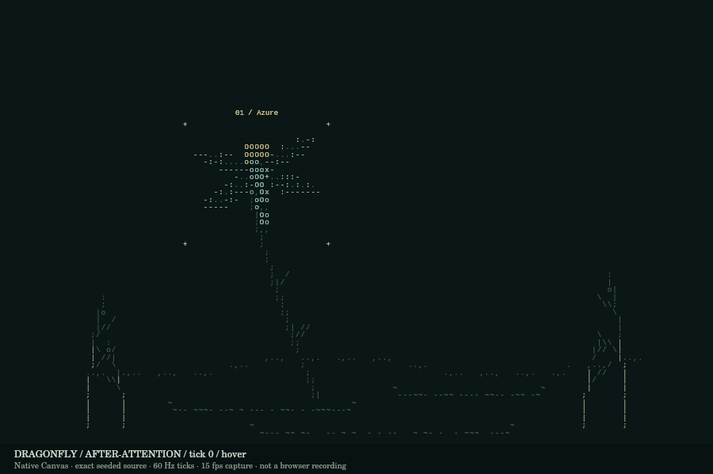

# Dragonfly flight-study review

Base: `b8f222dab868821f27bf2a64a98434f3483fc8e6`. Only `species/dragonfly/`
changes. The original public factories, options and cue/phase unions remain.

## What changed

- Four independently phased wings retain a dark gap between fore/hind pairs.
  Broader hindwing bases, light membrane, sparse veins and small tip markings
  replace the old dense cross-shaped wing texture.
- A deliberate cue anticipates, darts tail-first while preserving its heading,
  counter-pitches to brake, returns and recovers into hover. A bounded lane
  decision reduces interference with nearby wings without per-frame avoidance.
- Landing opens six legs onto a transverse twig. Wingbeat, attitude and grip
  settle before `perched`. Relaunch spools the wings, releases the feet and lifts.
- Fractional presentation interpolates poses, then rebuilds rigid geometry.
  It does not mutate simulation. Text capture now matches the last painted frame.
- Visible-anatomy touch selection and focused D/L/R shortcuts complement existing
  native controls. Offscreen demo controls retain bounded ordered intent while
  returning the canvas into view. The underlying host's suspension rules remain.

## Matched images

The captions identify these as **native Canvas source renders**. They are not
browser screenshots. Seed, settings, grid, camera and tick match across versions.







## Directed motion

Each GIF has 256 actual native Canvas frames at 15 fps, sampled from explicit
60 Hz simulation ticks 0–1020. The loop boundary restarts the replay.



[Three-visitor recording](pond-motion.gif) · [Representative states](attention-states.png)

## Verification

A clean archive of the exact base accepted the independent patch. Before and
after integration builds, every patched source/runtime file matched the working
checkout by SHA-256. `npm test` passed **628/628**, without skips. Full typecheck
passed. The package checker passed tarball repeatability, offline installation,
SSR imports and NodeNext/Bundler/core-server types; esbuild, Rollup, Webpack and
its browser harness were explicitly unrun.

Independent numerical review passed 16 boundary scenarios with zero clipping,
bounded acceleration and tail-first travel. The actual compiled demo passed
seven offscreen-intent/reentrancy/cancellation scenarios in an instrumented DOM
mock. These checks do not establish real-browser or physical-touch behavior.

Local Chromium could not launch (`socket() failed: Operation not permitted`).
The shared cloud browser could not reach the local preview (`ERR_CONNECTION_REFUSED`).
Browser CSS/layout/input, screen-reader checks and physical-device performance
remain acceptance work. No security override, deployment or merge was performed.

## Central integration

Species-local compiled runtime is included. Shared generated entry points and
root distributions are deliberately not in this change. After applying:

```sh
npm ci --ignore-scripts --no-audit --no-fund
node scripts/build.mjs
npm run typecheck
npm test
node scripts/check-package.mjs --report artifacts/dragonfly-package-check.json
```

To reproduce native captures, use an existing `@napi-rs/canvas` and FFmpeg:

```sh
# Set DRAGONFLY_CANVAS_MODULE to an installed Canvas module if necessary.
node --expose-gc species/dragonfly/scripts/capture-flight-study.mjs . /tmp/dragonfly-review after
node --expose-gc species/dragonfly/scripts/capture-flight-study.mjs . /tmp/dragonfly-attention after-attention 1 attention
node species/dragonfly/scripts/capture-flight-solo.mjs . /tmp/dragonfly-review after
node species/dragonfly/scripts/independent-boundary-sweep.mjs .
node species/dragonfly/scripts/independent-demo-intents.mjs .
```

`review-manifest.json` contains the source hashes, input log, capture sizes,
verification outcomes and explicit gaps. The downloadable review bundle also
contains all raw before/after frames, text grids and command logs.
