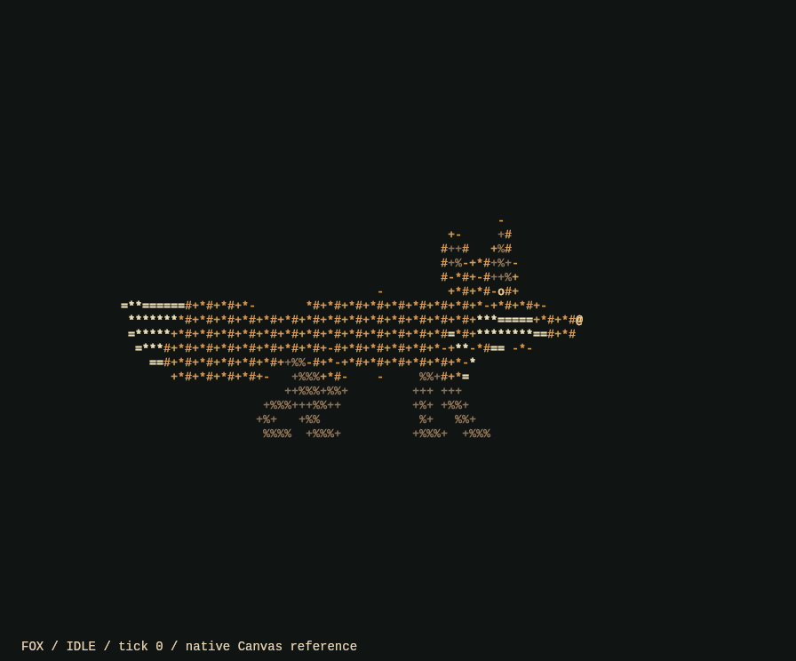

# Fox / Quiet in the Bracken

An original TypeScript fox with pointed ears, a long muzzle, four articulated legs and a broad, pale-tipped tail. Guidance evokes measured stalking and sniffing. A deliberate pounce follows **crouch → airborne → forepaw landing → recovery → cooldown**. Idle breathing and tail motion have independent phases.

**Status: species-local implementation and preview; central library integration pending.** This folder is additive to main `0e446c47b491b751d484e40db753ec725652b515`. It does not add a package export, registry entry or deployment. The current package proposal is inspected precisely in [COMPATIBILITY.md](COMPATIBILITY.md).



The GIF is rendered from the actual model and cell painter using native Skia Canvas. It is **not a browser recording**. It contains 181 sampled frames of the explicit 720-tick replay; its 15 fps capture cadence is not a performance measurement. The repeating GIF restarts the recorded excerpt; it is not advertised as a seamless motion loop.

## Open the demo

The committed `lib/*.js` and declarations are generated from `src/*.ts`. The demo has no runtime dependencies and makes no external requests:

```sh
git switch feat/animal-fox
python3 -m http.server 8000 --bind 127.0.0.1
```

From the repository root, open `http://127.0.0.1:8000/species/fox/demo/`. A module page needs an HTTP server. This is a local preview, not the deployed Pages demo.

Move the pointer or tap to place a guide. Use **Guide position**, **Invite a pounce**, **Pause**, **Reset seed**, **Side profile**, **Tail sway**, **Pounce height**, and **Still specimen** by keyboard or touch. The fox remains in a side profile; a guide behind it produces a cautious backstep. The authored pounce may travel toward either side of the guide, without a 3D turn. Biological gait fidelity is not claimed.

Below the artwork, **Capture current frame** reveals the real printable ASCII grid. Canvas-unavailable hosts receive a static text specimen. Reduced motion uses still idle/sniff/crouch poses and never starts automatic motion from pointer input.

## Typed model API

These are actual relative modules in this branch. There is no published `ascii-animals/fox` import yet.

```ts
import { createFox } from './species/fox/lib/model.js';
import type { FoxInput, FoxStepResult } from './species/fox/lib/types.js';

const fox = createFox({ seed: 17, facing: 'right', pounceHeight: 0.24 });
const guidance = [
  { type: 'guide', tick: 1, seq: 0, x: 0.8, y: 0.15 },
] as const satisfies readonly FoxInput[];

const result: FoxStepResult = fox.step(1, guidance);
if (result.kind === 'advanced') console.log(result.state.behavior.kind);

fox.step(2, [{ type: 'pounce', tick: 2, seq: 1 }]);
fox.configure({ tailSway: 0.1 });
const pose = fox.getPose(); // Original world-space polygons, legs and landmarks.
fox.setPaused(true);
fox.reset();               // Same seed/settings; still paused.
fox.dispose();             // Idempotent. Other model methods now throw.
```

See [the compile-checked example](examples/typed-usage.ts) and [positive/negative type fixtures](tests/types/contract.ts). `FoxSpecies`, `FoxOptions`, `FoxInput`, `FoxState`, `FoxBehavior`, `FoxStepResult`, `FoxPose`, and browser controller types are explicit. Behavior is a discriminated union, so only response phases have a captured pounce plan. State/options snapshots are recursively frozen. Pose sampling produces detached geometry; mutating a returned JavaScript pose cannot alter the simulation.

| Method | Semantics |
| --- | --- |
| `createFox(options?)` | Default seed 17, tick 0, idle, unpaused. Seed must be uint32. |
| `step(tick, inputs?)` | Exactly the next integer tick. At most 16 events. Atomic whole-batch validation. Paused steps validate but consume neither tick nor inputs. |
| `configure(patch)` | Validate before committing. Retain tick, sequence, pause and identity. An active response uses its captured settings through cooldown; updated morphology takes effect with correctly replanted paws afterward. |
| `getState()` / `getOptions()` | Frozen snapshots; no ambient clock or DOM reads. |
| `getPose()` | Pure original geometry, four joint chains and named anchors; no mutation of model state. |
| `setPaused(boolean)` / `isPaused()` | Explicit model playback policy. Invalid non-booleans throw. |
| `reset(seed?)` | Reset time, input sequence, guide, response and feet. Retain options and pause. Omitted seed repeats the model's seed. |
| `dispose()` | Repeatable. All other model operations throw afterward. |
| `staticFoxPose(options?, pose?)` | Deterministic still `idle`, `sniff` or `crouch`; does not advance a live model. |
| `normalizeFoxPointer(x,y,rect)` | CSS coordinates → [-1,1], finite values clamp. Native DOMRect is supported. Nonpositive size returns null. |

### Complete animal configuration

Omitted properties use the following defaults. Unknown fields, strings in numeric fields, nonfinite numbers, out-of-range values and fractional tick durations throw. There is no silent clamping of configuration. Seed and initial pause are creation inputs, not `configure()` properties.

| Option | Default | Accepted values | Meaning |
| --- | ---: | --- | --- |
| `facing` | `right` | `left`, `right` | Supported side profile; no front/yaw view |
| `scale` | 0.70 | 0.58–0.72 | Anatomy scale within verified world bounds |
| `breathing` | 0.009 | 0–0.025 | Local torso breathing amplitude |
| `tailSway` | 0.075 | 0–0.16 | Independent tail motion amplitude |
| `stalkSpeed` | 0.0018 | 0.0005–0.004 | Maximum root travel per fixed tick before easing |
| `sniffDepth` | 0.045 | 0–0.10 | Bounded head lowering |
| `pounceDistance` | 0.20 | 0.08–0.30 | Requested root travel, limited by guide and stage bounds |
| `pounceHeight` | 0.24 | 0.10–0.34 | Arc height in world units |
| `crouchTicks` | 24 | integer 12–60 | Anticipation |
| `airTicks` | 36 | integer 20–60 | Flight |
| `landingTicks` | 12 | integer 8–30 | Forepaw-first absorption |
| `recoveryTicks` | 36 | integer 12–90 | Settling |
| `cooldownTicks` | 72 | integer 30–180 | Repeated-pounce suppression |

Root travel stays within x = −0.2…0.2; ground is y = 0.55. Positive x is right and positive y is down. All model geometry remains in [-1,1]. Tail and breathing phases are independent of locomotion. Feet store world coordinates during stance; they do not slide with the root. Reaction timings are authored animation parameters, not biological measurements.

## Inputs and deterministic replay

`guide`, `leave`, and `pounce` carry the next `tick` and a globally increasing `seq`. Guide coordinates are finite normalized x/y values; finite overflow clamps to [-1,1]. The last guide/leave in sequence controls interest. At most one pounce begins in a tick. Pounces received while busy or cooling down return `ignored-busy` and are never queued.

The exact [replay fixture](evidence/replay.json) includes versions, seed, options and all six normalized events. Rendering after 1, 2 or 5 steps produces the same state/cells. This guarantee covers the same implementation/runtime and exact tick/event log; it does not equate two separately recorded mouse sessions or promise identical font pixels across platforms. Arbitrary serialized-state restore and version migration are unsupported.

Reset is an explicit return to the initial state. A response settles at its landing position rather than teleporting back to its launch point. Long-lived idle phases wrap periodically; the delivered GIF is a finite replay excerpt with a visible restart.

## Browser adapter and configuration

```ts
import { mountFox } from './species/fox/lib/browser.js';

const controller = mountFox(canvas, {
  fox: { seed: 17, paused: false, tailSway: 0.075 },
  grid: { cols: 112, rows: 44, monochrome: false },
  onInputs(batch) { /* Record accepted normalized events here if desired. */ },
});

controller.guide(0.8, 0.15);
controller.pounce();
controller.setPaused(true);
controller.reset();
controller.dispose();
```

`grid` defaults to 112×44, or 80×32 when the CSS width is below 640 px. Explicit values are integer columns 80–160 and rows 32–64. `monochrome` defaults false. Cell drawing preserves a 1:2 physical aspect and letterboxes arbitrary canvas sizes. The grid is a species-local orthographic proof renderer, not a new shared engine.

Optional `frameSource: FoxFrameSource` accepts `subscribe((timestampMs) => void): () => void`, structurally compatible with PR #2's actual scheduler declarations, rechecked unchanged at `8c530b10e8665e5b7d5cc528c8bd451cbbeef8e1`. Fox releases its own subscription only. It never disposes a borrowed scheduler. Otherwise it owns one RAF loop while active. This structural test is not proof of packed-package integration.

Optional `onStatus` reports phase/policy changes and counters. Optional `onInputs` receives consumed ordered batches; no unbounded replay log is retained internally. A callback exception disposes the mount and releases owned resources. The browser controller adds `guide`, `leave`, `pounce`, `showStaticPose`, `getStatus` and `exportText`. Its `getStatus()` is intentionally readable after disposal; other methods reject.

Policy causes compose independently: user pause, reduced motion, hidden document, offscreen, zero size and disposal. Each blocks automatic work. Reset/configuration never clears a user's pause. Transient guide/pounce input is discarded on suspension. A stale active guide is cleared with a recorded `leave` on the first resumed tick; fresh guidance can replace that pending reset. No hidden-time catch-up occurs. Live pointer movement cannot override reduced motion; deliberate controls choose a still pose.

The host requires Canvas 2D, ResizeObserver and IntersectionObserver; the demo retains text fallback if construction fails. System-font readiness triggers a redraw. No custom font binary is bundled. Resize/DPR changes rebuild bounded backing storage. Canvas work is bounded at 1280×768 CSS pixels, DPR≤2; at most five fixed ticks run per frame, and excess milliseconds are reported rather than silently replayed later.

## Build and verify

From `species/fox`:

```sh
npm ci --ignore-scripts
npm test
node --check demo/demo.js
```

TypeScript 5.9.3 is the sole development dependency, pinned with a lockfile. It is not shipped to the browser. Generated JavaScript/declarations are checked in so the demo works without an install. The source TypeScript is authoritative.

From the repository root, preserve the existing Cuttlefish checks:

```sh
node scripts/check-engine.cjs
node --check dist/artwork.js
node --check dist/app.js
python3 scripts/build-standalone.py
git diff --exit-code -- dist/
```

Native capture uses an already available `@napi-rs/canvas`, installed Liberation Mono and FFmpeg:

```sh
node scripts/render-evidence.mjs
```

The script can use the managed runtime path or a locally installed Canvas package. `FOX_EVIDENCE_FONT` selects an existing font; the exact file hash is recorded. It does not download or bundle a font. A real-browser smoke is separate:

```sh
FOX_CHROMIUM_PATH=/path/to/chromium node scripts/browser-smoke.mjs
```

That gate requires an existing Playwright installation. This environment's Chromium was denied before page launch, so **no real-browser pass or screenshot is claimed**. See [VALIDATION.md](VALIDATION.md), raw logs and the explicit unrun acceptance.

## Review evidence and integration handoff

- [Authoring template completed before implementation](AUTHORING.md) and [bounded machine-readable record](fox.authoring.json).
- [Native contact sheet](evidence/native-contact-sheet.png), [minimum-grid profiles](evidence/native-neutral-80x32.png), [capture provenance](evidence/native-render.json), and [review corrections](REVIEW.md).
- [Exact draft-library compatibility and adapter boundary](COMPATIBILITY.md).
- [Verification ledger and remaining acceptance](VALIDATION.md).

The coordinator owns the common geometry/material contract, canonical renderer, package exports, mixed-species composition, demo catalog and release. This branch deliberately touches only `species/fox/`. It changes no shared package, registry, README, workflow or existing artwork.
