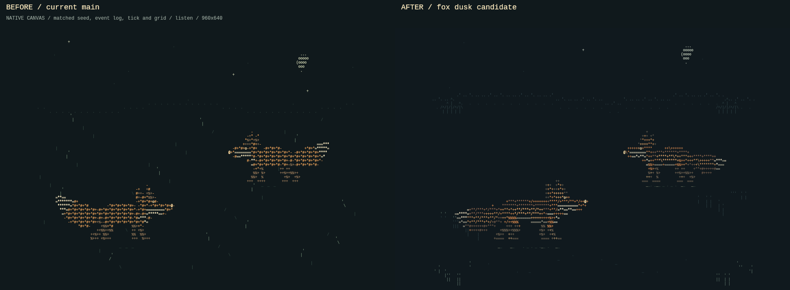
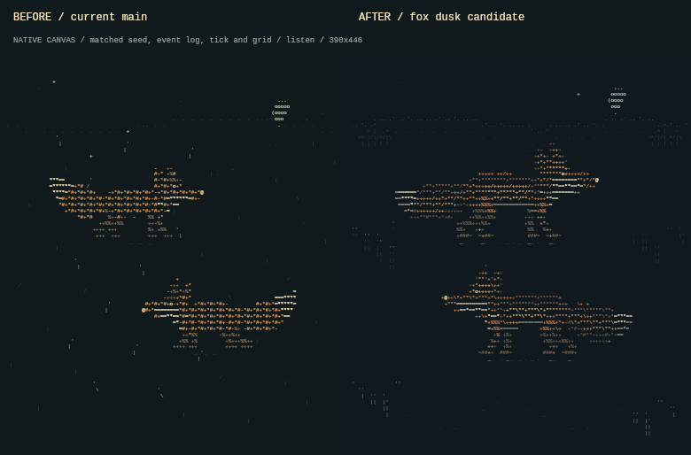
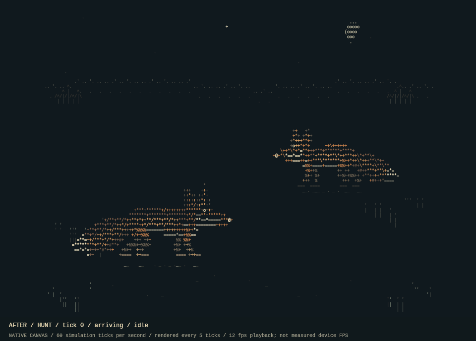
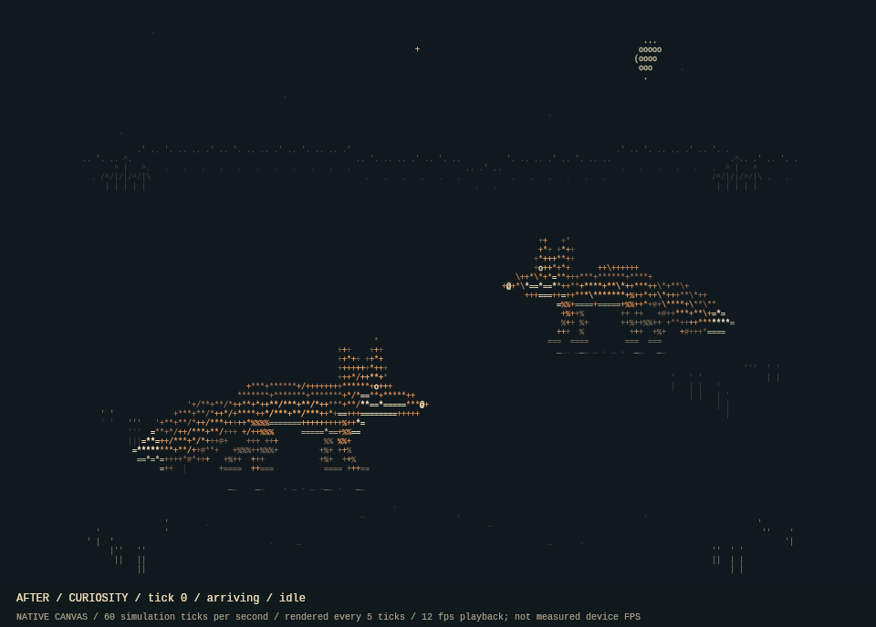

# Fox dusk review

**Fox-only candidate from main `b8f222dab868821f27bf2a64a98434f3483fc8e6`.** Source, package and native visual checks are complete. This remains a draft until real-browser interaction, motion and device performance are reviewed.

## What changed

The side-profile red fox has a darker dorsal plane, warm attached flank layers, quieter pale underside, shoulder and haunch tufts, and a long low-carried brush built from coat ribbons sharing one curve. A distant ridge and grouped grass banks leave an open hunting lane. The first two foxes receive wider phone lanes instead of a reduced landscape composition.

Two existing cues now carry distinct directed sequences. `rustle` gives the ears and head time to locate an invitation, creeps, plants and sniffs, then compresses, pounces, lands forepaws first and settles. `play` raises the tail before the head follows, then bows, steps, hops and recovers. The demo exposes play through **Tail curiosity** and focused-canvas **C**. Existing pointer, tap and keyboard controls remain. Tail-first curiosity and the exact timing are expressive choices, not behavioral-science claims.

Paws planted ahead of the body now retain their contact until the body catches up. Shoulder weight derives from actual foot swing; loaded paws spread and recovery absorbs landing weight. Removed independent scene-anchor drift prevents the scenery-relative contacts from floating.

## Matched before and after

These images render the exact compiled fox with **native Skia Canvas**, not a real browser. Both sides use seed 17, `dusk-hunt`, two foxes, labels off and matched ticks/event logs. State may legitimately differ after the choreography changes. The full evidence archive includes all 32 full-size captures and ASCII text per version, source/font/state hashes, videos and logs.

### Desktop: 960 × 640, 160 × 64 cells



### Phone-sized canvas: 390 × 446, 112 × 64 cells



The matched approach is also available at [desktop](matched-hunt-age-075-desktop.png) and [phone](matched-hunt-age-075-phone.png) size.

## Directed motion

Both excerpts encode 109 deterministic native frames, five simulation ticks per frame at nominal 12 fps. This shows the intended time scale; it is not a measured rendering frame rate. Each fresh director receives its cue at tick 60, actor 0, target `(-.04, .69)` and ends at tick 540. The GIF loops restart the excerpt.





Inspect the [hunt state sheet](native-after-hunt-contact.png) and [curiosity state sheet](native-after-curiosity-contact.png) for actual action/model-phase labels. Stills and state sheets were visually reviewed; real-browser continuous playback is pending.

## Exact validation and limits

- **70/70 fox tests passed**, including seeded replay, geometry budgets, planted contacts, directed timing, routing and explicit lifecycle mocks.
- In a disposable exact-source copy: **full build and typecheck passed**, **13/13 integration tests passed**, and the local tarball passed strict NodeNext/Bundler consumers, 14 negative assertions per mode and throw-on-DOM SSR imports.
- The standalone package type fixture first failed before central `lib/` generation; the after-build check passed. The initial failure is retained in the full evidence.
- Public types and factory exports, seed/input contract, geometry/cell/input budgets and lifecycle source are preserved. Historical cross-version pose/cell equality intentionally changes.
- **Real browser: blocked before page initialization.** Chromium failed on denied socket/ptrace operations. A supported cloud preview could not reach the local server, then its error-page URL was policy-blocked; no workaround was attempted. No real-browser input, layout, resize, reduced-motion or disposal test passed here.
- **Native performance cost increased.** One shared-host run with 30 warmup/120 samples measured total p50 **21.930 → 29.505 ms**, p95 **47.241 → 58.837 ms**. Each sample advances five ticks and renders once. No browser/device FPS or performance pass is claimed.
- Physical phone use, screen-reader behavior and browser-font rendering remain open. The artwork supports discrete left/right profiles, not continuous yaw.

See [VALIDATION.md](VALIDATION.md), [review-manifest.json](review-manifest.json), [70-test log](fox-tests-final.log), [package commands](package-verification.json) and [installed consumer report](package-consumer.json). Source and compiled hashes in the manifest match the final native capture and the independently built copy. The independent read-only source review found no concrete blocker before draft review.

## Central integration

Only `species/fox/**` changes. The branch includes fox-local compiled modules. Shared engines, other species, central generated entry points/distribution and workflows were not edited. Central integration should regenerate the existing outputs with:

```sh
npm run build
npm run typecheck
node --test test/fox-integration.test.mjs test/fox-director-integration.test.mjs species/fox/tests/*.test.mjs
```

On a host with an already supported Playwright/Chromium installation, complete the pending browser gate:

```sh
node species/fox/scripts/browser-dusk-smoke.mjs --out=/absolute/review-evidence/browser
```

Native reproduction requires an existing `@napi-rs/canvas`, `ffmpeg`, `fc-match` and Liberation Mono (or an explicit `FOX_EVIDENCE_FONT`). The script does not download dependencies:

```sh
node species/fox/scripts/capture-dusk-review.mjs --source=/absolute/repository --out=/absolute/review-evidence/after --label=after
```

References and rights are recorded in [DUSK-AUTHORING.md](../../DUSK-AUTHORING.md). No reference photos or font binaries are included. No merge, package publication or deployment is part of this review.
