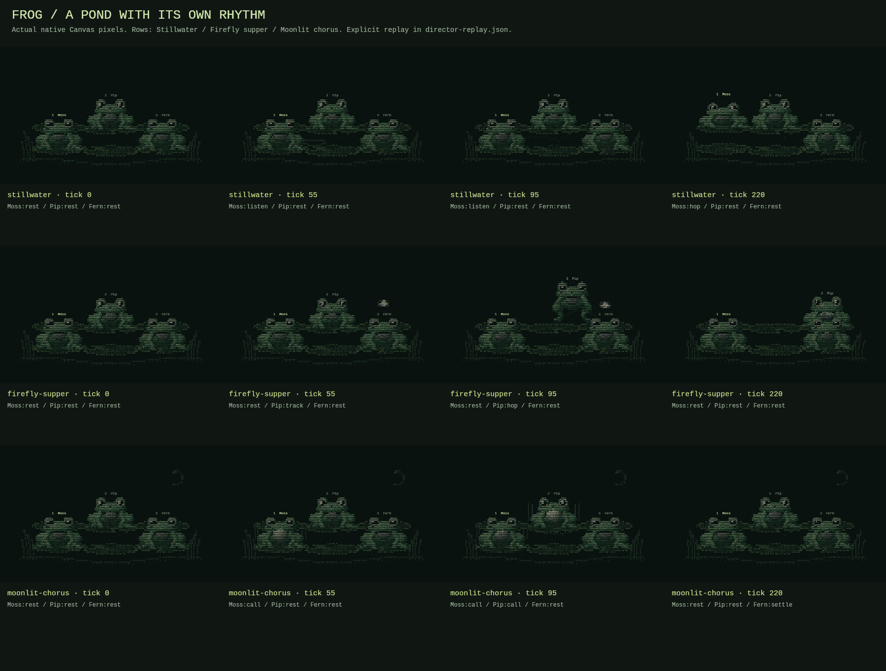

# Frog / A pond with its own rhythm

The integrated TypeScript frog now has an optional **pond director**: one to three named frogs, six original lily pads, individual roles, safe hops and landings, a firefly hunt, water attention, and a bounded call-and-answer chorus. The existing single-frog factory remains the default when `director` is omitted.



The new images and replay are actual native Canvas renders of this source, **not browser or deployed captures**. The live baseline was inspected in a browser; the cloud browser could not reach the new local demo. See [director/EVIDENCE.md](director/EVIDENCE.md) for the exact checks, critique, corrections and remaining gates.

## Explore

Build from the repository root with the already specified TypeScript dev dependency:

```sh
npm ci --ignore-scripts
npm run build
python3 -m http.server 8000 --bind 127.0.0.1 --directory dist
```

Open `http://127.0.0.1:8000/frog/`. This uses the actual packaged factory and shared scheduler. The buildless source demo at `species/frog/demo/` also works when serving the repository root; its low-level mount uses a standalone RAF unless a frame source is provided. Neither demo requires the marine global.

Choose **Stillwater**, **Firefly supper**, or **Moonlit chorus**. Set one to three inhabitants, a pad layout and cue tempo; assign Moss, Pip and Fern different roles. The selected frog can hop to a free reachable pad, call, or watch a firefly above a safe perch. Tapping water makes a ripple and attracts the nearest available listener. A departure protects its destination until touchdown, and neighbors answer calls only once.

Tap frog glyphs to select their owner. Focus the scene and use1/2/3 to select, arrows to aim, Enter/Space to hop, C to call, H to invite a hunt, R to ripple, Escape to clear. Every action also has a native control. Pause freezes the scene; fixed pose and call/hunt/ripple studies remain available. OS reduced motion never schedules automatic movement. Reset preserves pause.

## Typed API

```ts
import { createFrogArtwork } from 'ascii-animals-review/frog';
const pond = createFrogArtwork(canvas, {
  seed: 23,
  director: { scene: 'moonlit-chorus', count: 3, layout: 'arc', tempo: 1 },
  preview: { cols: 180, rows: 100, labels: true },
});
pond.selectFrog(1);
pond.hunt({ x: .7, y: -.5 });
// After that encounter, or instead of it:
pond.pause();
pond.call(); // deliberate still expression, no motion
pond.updateDirector({ scene: 'stillwater' }); // reset; preserves pause
pond.dispose();
```

The package remains private/unpublished. See [the complete director API](director/API.md) for defaults, validation, discriminated state/input/result types, replay examples, operation/reset semantics, input controls and resource budgets. [docs/FROG-API.md](../../docs/FROG-API.md) describes the existing integrated factory. No shared contract or export rewrite is part of this feature.

`src/*.mts` is canonical; `generated/*.mjs` and `.d.mts` are compiler output. The pure `createFrog`/`stepFrog`/`sampleFrog` body APIs retain the original crouch→ballistic flight→landing→recovery→cooldown semantics. New pure `createFrogPond`/`stepFrogPond` and explicit director types compose those bodies. One shared scheduler subscription and one glyph field serve the entire ensemble.

## Reproduce checks and native evidence

```sh
npm test
node --test test/frog-director-integration.test.mjs
npm run typecheck
node node_modules/typescript/bin/tsc -p species/frog/tests/tsconfig.director.json
npm run check:package
node --test species/frog/tests/native-preview.test.mjs
node --test species/frog/tests/native-director.test.mjs
node --expose-gc species/frog/scripts/render-director-evidence.mjs
```

Native evidence needs an installed `@napi-rs/canvas`. Set `FROG_CANVAS_MODULE` to its path if necessary. `FROG_FONT_FILE` optionally identifies an installed Liberation Mono font; the capture records its hash. No font binaries are redistributed. The replay script emits explicit frame PNGs and contact sheets; the evidence guide includes the GIF command.

The [pre-code authoring record](director/AUTHORING.md) documents the gap/behavior/scene matrix, anatomy, event protocol, budgets and acceptance targets. [The base manifest](director/base-manifest.json) pins the actual main and inspected source. Geometry, environment and choreography are original procedural work. Existing historical authoring/evidence under the parent directory describes the first frog implementation and must not be treated as evidence of this director revision.
