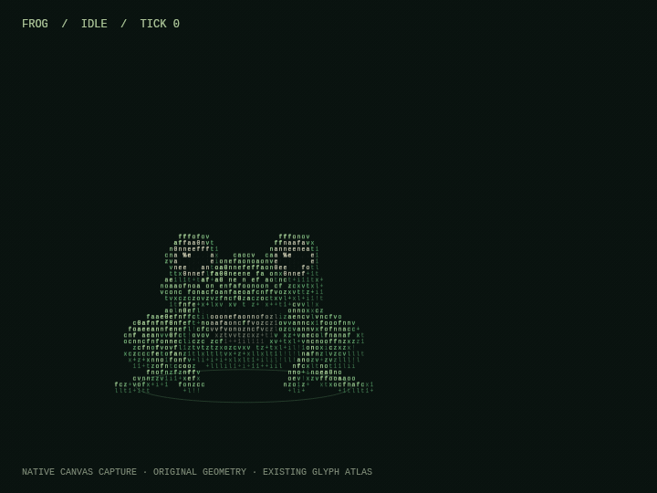
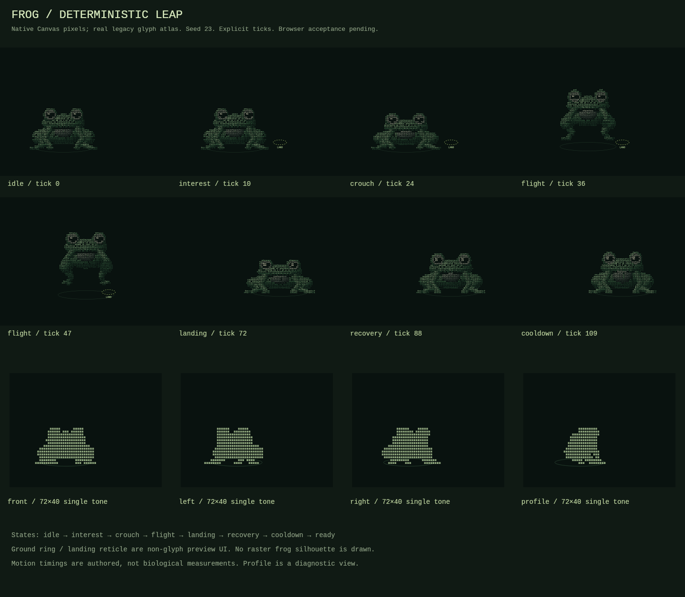

# Frog / A little leap

An original TypeScript-first ASCII frog with a quiet throat-sac breath and a deliberate **crouch → bounded ballistic leap → landing compression → recovery → cooldown**.

**Recovered species source, now integrated through the typed `./frog` factory. Browser acceptance and catalogue availability are tracked separately.** This directory adds no root package export, registry entry or deployed page. See [INTEGRATION.md](INTEGRATION.md) for the exact main/PR2 compatibility boundary and [EVIDENCE.md](EVIDENCE.md) for executed checks and open acceptance.



This GIF uses the original frog geometry and the repository's real glyph atlas/projection through a native Canvas capture. It is **not a browser recording**. The ground ring and landing reticle are preview UI; the animal itself consists of character sprites. The replay is 101 frames at 20fps, produced from explicit 60Hz simulation ticks.

## Run the local demo

From the repository root, use an existing Python runtime:

```sh
python3 -m http.server 8000 --bind 127.0.0.1
```

Open **http://127.0.0.1:8000/species/frog/demo/**. The committed generated modules make a rebuild unnecessary for preview. Serve the repository root: the local adapter intentionally reuses `dist/artwork.js`. ES modules are not verified through `file:` URLs.

Point to preview a reachable landing. Tap/click the scene to commit, or focus the canvas and use arrows to aim and Enter/Space to leap. The Landing select and native Leap button provide another keyboard/touch route. Pause freezes the current pose, including gaze. Reset preserves pause. Static pose choices pause on rest, crouch, airborne or landing poses. A live reduced-motion preference stops scheduling; deliberate Leap actions cycle static poses without travel.

## TypeScript source and API

`src/*.mts` is the authoritative source. `generated/*.mjs` and `.d.mts` are compiler output, committed for a buildless demo and typed consumers. This is not a published package import. Runtime code has no third-party dependencies; optional tests/capture use development tools.

```ts
import { createFrog, stepFrog, sampleFrog } from './species/frog/generated/index.mjs';
import type { FrogInput, FrogSample } from './species/frog/generated/index.mjs';

let frog = createFrog({ seed: 23, config: { jumpHeight: .85 } });
const events: readonly FrogInput[] = [
  { type: 'target', x: .65, y: .05, tick: 1, seq: 0 },
  { type: 'leap', tick: 1, seq: 1 },
];
frog = stepFrog(frog, 1, events).state;
for (let tick = 2; tick <= 60; tick++) frog = stepFrog(frog, tick).state;
const samples: FrogSample[] = [];
const geometry = sampleFrog(frog, point => samples.push(point));
console.log(frog.behavior.kind, geometry.count); // landing; 17,918 samples
```

In this schedule the leap begins at tick 1, flight starts at tick 15, and landing begins at tick 57. Read phases from the discriminated state; do not infer them from wall time.

For a browser host, after loading the pinned `dist/artwork.js`:

```ts
import { mountFrog } from './species/frog/generated/controller.mjs';

const frog = mountFrog(canvas, { seed: 23, paused: true });
frog.target({ x: .7, y: .2 });
frog.setPaused(false);
frog.leap();
frog.updateConfig({ jumpHeight: .7 }); // resets simulation, keeps user pause policy
frog.updatePreview({ view: 'left' });  // preserves simulation
frog.reset({ seed: 8 });
frog.dispose(); // idempotent
```

The pure `frogSpecies` object exposes literal `id: 'frog'`, version 1, maxSamples 32000, defaults, create/step/sample. `FrogBehavior` is a discriminated union: idle, interest, crouch, flight, landing, recovery, cooldown. Crouch/flight carry an immutable `LeapPlan`; other phases cannot contain one. Inputs are target/leave/leap unions stamped with the next integer tick and a globally increasing sequence. `FrogStepResult` reports `startedLeap` and `ignoredLeaps` alongside immutable state.

### Configuration

Every supplied field validates before changes. Unknown keys, nonfinite numbers, strings, out-of-range values and fractional tick counts reject. Configuration is copied/frozen; nested positions/plans/state are frozen. JavaScript callers receive the same runtime validation. Explicit `undefined` configuration values reject; omit optional fields instead.

| Field | Default | Accepted values | Meaning |
| --- | --- | --- | --- |
| `seed` (creation/reset only) | 23 | integer 0…4,294,967,295 | Stable idle phase; never ambient randomness |
| `size` | 1 | .75…1.15 | Model scale |
| `jumpHeight` | .85 | .45…1.1 | Peak height, model units |
| `maxDistance` | 1.2 | .2…1.5 | Maximum normalized planar leap distance |
| `crouchTicks` | 14 | integer 6…60 | Anticipation |
| `flightTicks` | 42 | integer 24…90 | Constant-acceleration arc duration |
| `landingTicks` | 12 | integer 6…36 | Compression and restitution |
| `recoveryTicks` | 24 | integer 6…120 | Return to neutral pose |
| `cooldownTicks` | 18 | integer 1…120 | Busy period; repeats are not queued |
| `throatAmplitude` | .06 | 0….08 | Gentle idle expansion |

Preview defaults: front view, maximum 144 columns/80 rows, single-tone off. Limits are 72…180 columns and 40…100 rows; actual rows/columns preserve the existing 1:1.35 cell aspect. Views are front, left/right three-quarter, and **diagnostic profile**. The predeclared minimum-grid all-anchor recognition gate remains partial; do not advertise all views as accepted.

### State and lifecycle semantics

- Pure stepping requires exactly `state.tick + 1`. At most eight ordered events per tick; a complete invalid batch rejects without modifying state. Same-tick sequence order is meaningful.
- A leap latches the reachable target. Later pointer changes affect only a future preview; they cannot bend an active flight. Busy/cooldown leaps are ignored without a queue.
- Logical state/cell determinism is for the same version, config, seed and tick-stamped event log in the tested JS runtime. Render grouping 1/2/5 does not change results. Cross-engine trigonometry and cross-font pixels are not promised identical.
- `updateConfig` resets tick, sequence, position, preview and active behavior with the same seed. `updatePreview` changes only presentation. `reset` can change the seed; both reset paths preserve explicit pause/reduced-motion policy.
- Hidden, offscreen, zero-size, undersized, pause and reduced motion compose. No self-rescheduling RAF while suspended. Resume discards suspended wall time. A long visible stall runs at most five ticks and records dropped milliseconds.
- Dispose cancels RAF, removes listeners, disconnects observers and shrinks owned backing stores. Dispose twice is safe. Subsequent mutation/state/export calls throw; status remains readable. One instance's disposal leaves another intact.
- Arbitrary serialized-state restoration, cross-version migrations, a live event recorder, terminal animation and framework adapters are not implemented.

## Build and verification

Use an installed **TypeScript 5.9.3**; the script does not download anything:

```sh
FROG_TSC=/absolute/path/to/typescript/lib/tsc.js node species/frog/scripts/build.mjs
node --test species/frog/tests/core.test.mjs species/frog/tests/geometry.test.mjs species/frog/tests/lifecycle.test.mjs
node --test species/frog/tests/demo.test.mjs
node scripts/check-engine.cjs
node --check dist/artwork.js
node --check dist/app.js
```

The build also compiles positive/negative consumers of the emitted declarations under strict NodeNext with exact optional fields and no unchecked indexed access. `@ts-expect-error` assertions fail if an invalid call becomes silently accepted.

Optional actual native Canvas tests/captures use installed `@napi-rs/canvas` (tested 0.1.100). Set `FROG_CANVAS_MODULE` to its module directory when it is not resolvable locally. A system Liberation Mono font was used, without redistribution; `FROG_FONT_FILE` selects an installed font file for repeatable capture.

```sh
node --test species/frog/tests/native-preview.test.mjs
node species/frog/scripts/render-evidence.mjs
ffmpeg -y -framerate 20 -i species/frog/evidence/frames/%04d.png -filter_complex '[0:v]split[a][b];[a]palettegen=stats_mode=diff[p];[b][p]paletteuse=dither=bayer:bayer_scale=3' -loop 0 species/frog/evidence/frog-leap.gif
```

For real browser acceptance, use an installed Playwright and Chromium:

```sh
node species/frog/scripts/browser-smoke.mjs
```

`FROG_PLAYWRIGHT_MODULE` and `FROG_CHROMIUM` select existing installations. This environment denied Chromium launch before page load, so no browser pass or browser performance claim is made. The script records success/failure and can run the pending checks on a supported machine.

## Provenance and review

See [AUTHORING.md](AUTHORING.md), committed before implementation, for anatomy, reference rights, choreography, event protocol, budgets and original acceptance targets. Geometry, code and UI were independently authored for this frog; no online ASCII art, model or raster frog image is used. The existing project renderer is reused in place. No font binaries are bundled and the repository's license choice remains with its owner.



Review found forelimbs blending into the belly. One bounded revision lifted the lower belly and moved elbows/wrists slightly outward while preserving shoulder attachments, foot planting, sample count and timing. Full-size recognition improved. Minimum-grid anatomy and normal-speed human motion review remain open, as do real browser, accessibility, target-device timing and heap acceptance.
