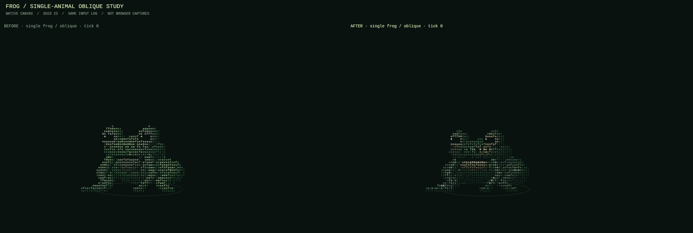
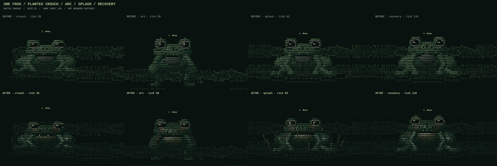
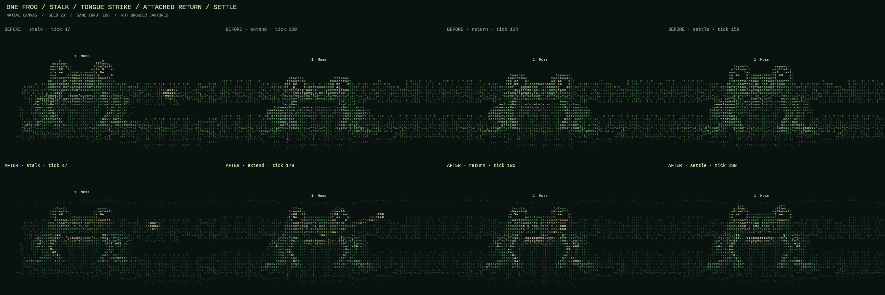
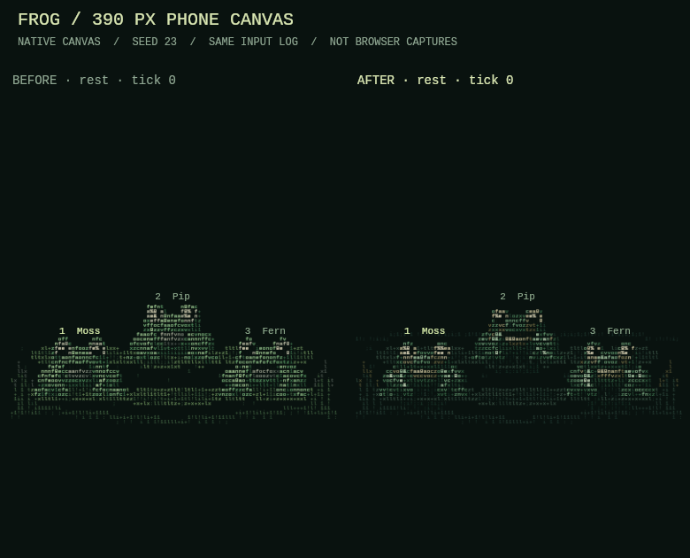

# Frog / wetland movement review

**Ready for central code review; real-browser acceptance remains open.** This revision owns only `species/frog/`, based on verified main `b8f222dab868821f27bf2a64a98434f3483fc8e6`. It adds a lower wet silhouette, planted compression, gathered flight, touchdown water, and a supported feeding sequence. No shared renderer, scheduler, public entry point, other species or workflow is changed.

The [compact manifest](manifest.json) records the source fingerprint, executed checks and remaining gates. [The pre-code brief](AUTHORING.md) records anatomy, references, rights, interaction and budgets. Canonical code is in `../src/`; frog-local compiler output is included in the patch. Central integration regenerates the package and demo outputs.

## What changed

- **Anatomy/material:** a lower broad head, horizontal pupils, substantial folded thighs, slimmer throat and coherent brow/cheek/knee highlights. Restrained gold markings and a pale jaw distinguish surfaces without increasing the original 17,918 anatomical samples.
- **Crouch → arc → splash:** all four principal foot contacts remain fixed in x/y/z as the body compresses. Hindlegs extend early and gather before contact along the unchanged ballistic root trajectory. A short character-sampled water crown starts at touchdown; expanding rings outlive the droplets.
- **Stalk → tongue → return:** supported lowering and gaze precede the safe approach. The strike waits for landing/recovery, projects from the actual transformed mouth, holds the insect at contact, carries it back, then settles. The visible insect and tongue use one bounded endpoint. A blocked approach visibly stops short and cannot claim a catch.
- **Habitat:** quieter horizontal water fragments, a far bank, broken reflections and contact shadows distinguish depth layers. These remain below the frog's contrast.

Public factory/controller signatures, configuration and state/input shapes remain unchanged. The documented authored `FROG_POND_LIMITS.strikeTicks` value changes from 12 to 30 ticks (0.5 seconds at the fixed 60 Hz model clock); this is intentionally slowed for ASCII readability. Valid long body timings extend the encounter's insect lifetime. No new timer, observer, listener, asset or lifecycle owner is introduced.

Pointer/touch frog selection, free-pad hops, open-water ripples, scroll-drag cancellation and semantic action buttons retain their existing routes. Focused 1–3/arrows/Enter/Space/C/H/R/Escape actions use that same controller. Paused/reduced-motion Hunt presents a deliberate contact still with no advancing clock.

## Matched visual evidence

All images below are **actual native `@napi-rs/canvas` rasters**, not illustrations, browser screenshots, deployed evidence or physical-phone captures. Both revisions use seed 23, the same event logs, font, views, grid and fixed 60 Hz timeline. Canvas sizes are 1200 × 700 and 390 × 520 at DPR 1. The latter is a phone-width portrait canvas stress view, not the demo's CSS page layout; the mobile demo canvas uses a 4:3 aspect/minimum-height rule.









| Review | Desktop | Phone width |
| --- | --- | --- |
| Full rest composition | [Before/after](evidence/frog-before-after-desktop.png) | [Before/after](evidence/frog-before-after-phone.png) |
| Three-frog hop replay | [GIF](evidence/frog-hop-desktop.gif) | [GIF](evidence/frog-hop-phone.gif) |
| Three-frog hunt replay | [GIF](evidence/frog-hunt-desktop.gif) | [GIF](evidence/frog-hunt-phone.gif) |
| One-frog hop replay | [GIF](evidence/frog-solo-hop-desktop.gif) | [GIF](evidence/frog-solo-hop-phone.gif) |
| One-frog hunt replay | [GIF](evidence/frog-solo-hunt-desktop.gif) | [GIF](evidence/frog-solo-hunt-phone.gif) |
| Representative phone states | — | [One frog](evidence/frog-solo-phone-motion.png), [three frogs](evidence/frog-phone-motion.png) |

The full evidence bundle contains 92 selected raw PNGs, eight exact frame copies of the lifted crown, nine comparison sheets and eight GIFs. Each revision/viewport also has 344 recorded motion frames; reproducible intermediate frames are omitted from git and the compact bundle. GIFs sample every third model tick at 20 fps. The before and after sides share elapsed time; the slower feeding choreography is not retimed to hide its duration.

Contact sheets compare the same named phases with actual ticks printed. Successful hunt contact is tick 120 before and 179 after because feeding now waits for a recovered perch and has a longer strike. Hop crown panels use the exact recorded tick 93 frame on both revisions; original tick 83 PNGs remain the touchdown/impact record. [Composition metadata](evidence/composition.json) declares all crops/scaling and exact derived frame paths. [Capture audit](evidence/capture-audit.json) verifies source hashes, inputs, frame counts and unique motion frames.

### Visual verdict and limits

The single frog's brow, haunch and forefoot separation are clearer, the planted body compression reads, and the tongue now extends past the cheek to a distinct insect. The lifted crown reads as brief side droplets; it is deliberately restrained. The one-frog phone-width hunt shows extension and a shortened attached return.

**Three-frog anatomy/action readability at 390 pixels is partial:** limb gaps become small and a rear-pad hunt can overlap another frog in the unchanged front camera. The fixed pond camera also leaves substantial upper negative space in the portrait stress canvas. The one-frog review complements this limitation; it does not replace the three-frog evidence. Actual mobile DOM layout, physical touch, screen-reader operation and browser performance remain unverified.

### Native atlas qualification

This native backend retained excessive deferred work when repeatedly blitting a mutable Canvas atlas and was killed before completing a full-resolution frame. The review/test host decodes the exact completed atlas PNG into an immutable native Image and substitutes it only at `drawImage`. Production code, cells, geometry, event logs and state are unchanged. Both revisions use the same bridge.

This path is **not pixel-identical** to mutable-atlas native sampling. A 360 × 260 comparison changed 844 of 93,600 pixels (0.90%); maximum channel delta was 7/255, mean absolute channel delta 0.00854/255. The foreground masks agreed on 99.935% of their union. [Measured values](evidence/native-atlas-parity.json) accompany the captures. None of this establishes browser pixel parity or browser memory performance.

## Executed verification

| Command / scope | Final result |
| --- | --- |
| `npm test` (includes full build) | 618/618 pass on final source |
| Explicit pond, director lifecycle/demo, wetland choreography and feeding endpoint suites | 39/39 pass |
| `npm run typecheck` and frog director TypeScript fixture | Pass, after build completed |
| `npm run check:package` | Pass with its declared unrun optional checks; local tarball/SSR/types verified |
| Exact packed frog modules versus generated source bytes | All five changed runtime modules match |
| New native controller/demo regressions on pinned baseline | 2/2 pass |
| Same native regressions on final candidate | 2/2 pass |
| Browser runner syntax | Pass; browser scenarios not executed |

The endpoint sweep covers 96 seed/size/count/actor/view combinations, including 28 that exercise the reach cap. Contact moves at most 0.0033693 body scales against a declared 0.05 limit. Separate tests check fixed planted contacts, early extension/late gathering, delayed capture, continuous attached return, extended valid timings, a blocked miss, exactly one touchdown splash and ignored busy-hop inputs.

The numerical composite overlaps two calls, a strike and six ripples in all three scenes: peak 59,075 samples / 5,321 environment samples. An independent no-op-Canvas stress review with six simultaneous landing crowns observed 59,791 / 6,037. Native motion captures peaked at 58,499. All remain within the unchanged 60,000 / 6,246 caps; the numerical probes are not pixel evidence.

### Blank canvas and stale labels

The new suite runs the real generated controller/demo with native Canvas pixels and controlled DOM/layout/observer doubles. It tests 720 × 440, 390 × 520 and 360 × 260 at DPR 2, offscreen resize preserving the last bitmap, scene labels/radio state updating while offscreen, restoration before a lagging intersection callback, zero-size recovery, reduced-motion stills and disposal. Labels are disabled for the bitmap-only checks, so text cannot make an empty animal scene pass. Fixed bright-pixel/color and opacity gates check actual image content.

The controller/demo generated files remain byte-identical to baseline: existing deferred-resize, immediate state-publication and viewport-reconciliation protections are preserved. [Regression qualification](logs/regression-qualification.md) and raw baseline/candidate logs describe the bridge and controlled host precisely.

### Real-browser blocker

Ordinary local Playwright/Chromium startup failed with `socket() failed: Operation not permitted` in the Chromium process singleton. The cloud browser could not reach the local server (`ERR_CONNECTION_REFUSED`), and the subsequent browsing-issue path was rejected by its URL authority policy. No workaround, external deployment or Work conversion was used. The shipped browser runner remains **unexecuted**; central review should run it in a permitted browser environment before treating browser acceptance as complete.

The older mutable-atlas native suites were not rerun as passing evidence. Initial native fixture decoding produced blank glyph pixels and correctly failed the new pixel gate; asynchronous decode fixed the harness. An initial TypeScript run overlapped a build clearing `lib/`; it was repeated sequentially and passed. Final results and hashes, rather than superseded attempts, determine this review's claims.

## Central integration and reproduction

From the repository root after applying the patch:

```sh
npm ci --ignore-scripts
npm run build
npm test
npm run typecheck
node node_modules/typescript/bin/tsc -p species/frog/tests/tsconfig.director.json
node --test species/frog/tests/pond.test.mjs species/frog/tests/director-lifecycle.test.mjs species/frog/tests/director-demo.test.mjs species/frog/tests/wetland-choreography.test.mjs species/frog/tests/feeding-endpoint.test.mjs
node --test species/frog/tests/native-regressions.test.mjs
npm run check:package
```

`npm run build` is the central generation command for `lib/`, shared package entry points and demo output. A frog-local compile is `node node_modules/typescript/bin/tsc -p species/frog/tsconfig.json`. No generated shared output is part of this patch.

Native evidence requires an existing `@napi-rs/canvas`; use `FROG_CANVAS_MODULE` if needed. The font defaults to installed Liberation Mono and is hashed in each capture. FFmpeg composes the GIFs. From the candidate root, with a separate clean baseline checkout:

```sh
git worktree add --detach ../frog-baseline b8f222dab868821f27bf2a64a98434f3483fc8e6
node --expose-gc species/frog/scripts/render-wetland-review.mjs --root=../frog-baseline --variant=before
node --expose-gc species/frog/scripts/render-wetland-review.mjs --root=. --variant=after
node --expose-gc species/frog/scripts/render-wetland-review.mjs --compose=true
FROG_TEST_ROOT=../frog-baseline node --test species/frog/tests/native-regressions.test.mjs
```

For the outstanding real-browser gate, build first, serve `dist/`, then use the supplied runner with an installed Playwright/Chromium:

```sh
python3 -m http.server 8000 --bind 127.0.0.1 --directory dist
# In a second terminal:
node species/frog/scripts/check-browser-regressions.mjs http://127.0.0.1:8000/frog/ /absolute/review/browser
```

The runner records source/served-asset hashes, real canvas content, page/canvas screenshots, desktop and emulated phone viewports, scene-label changes, pointer/touch/keyboard routes, reduced motion, actual hop/hunt progression and cleanup. A successful run is still not physical-device or frame-time/heap evidence.
