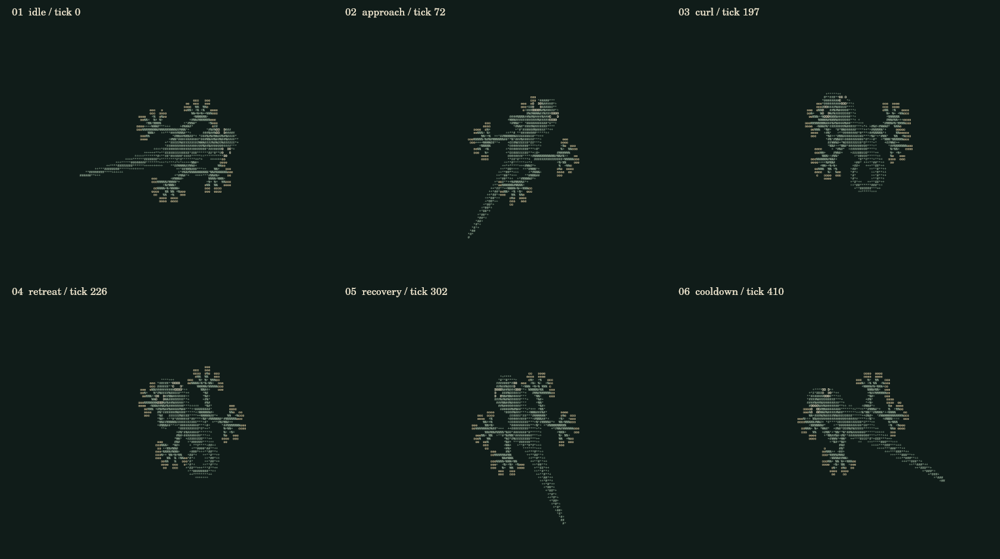

# Gecko — A small act of courage

An original TypeScript gecko that creeps toward a guide with planted toes. A
deliberate surprise curls its attached tail, prompts a short retreat, then gives
way to curious recovery.

**Species-local implementation; central library integration pending.** This
directory adds no shared engine, package export, registry or deployed demo.



The locally generated GIF contains 201 actual native Canvas frames from the compiled geometry and
cell painter. It is not a browser recording. The 10.05-second replay has an
intentional reset cut at its loop boundary.
The connected GitHub app rejected that binary upload without giving a reason,
so the GIF is supplied separately in the task response and can be regenerated
with `scripts/capture.mjs`. PNG checkpoints/contact sheets are committed here.

## Run

Open [gecko.html](gecko.html) as an offline file in a modern browser, or serve the
repository root:

```sh
python3 -m http.server 8768 --bind 127.0.0.1
```

Open `http://127.0.0.1:8768/species/gecko/`. No installation or external request is
needed by the committed demo. All JavaScript/declarations derive from `src/*.ts`.

Use the pointer or direction buttons to guide. A stage tap guides without
startling; **Startle gecko** is the deliberate keyboard/touch reaction. **Pause**
and **Reset** preserve motion preferences. Arrows and Space work only with stage
focus. Touch scrolling remains available. Reduced motion keeps a still portrait;
Startle selects a static curled pose. The smallest supported host is 360 CSS
pixels wide with a 112×50 grid; smaller hosts show a description/text alternative.

## TypeScript-first API

The implementation is TypeScript, with declarations generated from the same
source. This local pure entry imports without DOM globals:

```ts
import { geckoSpecies } from './compiled/species.js';
import type { GeckoInput, GeckoState } from './compiled/species.js';

const gecko = geckoSpecies.create({
  seed: 37, options: { creepSpeed: 0.10, toeSpread: 1.05 }
});
const input: GeckoInput = [
  { type: 'guide', tick: 1, seq: 1, x: 0.9, y: -0.9 }
];
const result = gecko.step(input); // exactly one 1/60-second tick
const state: GeckoState = result.state;
geckoSpecies.sample(state, point => {
  // Finite world x/y/z, tone, named material, part, stable sample ID.
});
gecko.update({ creepSpeed: 0.12 }); // retains time, contacts, seed, behavior
gecko.reset({ seed: 37 });        // retains resolved artistic options
gecko.dispose();                 // terminal, idempotent
```

`GeckoSpecies` is an implemented local facade, not a claim that a package import
`ascii-animals/gecko` or a general registry exists. Direct functions also remain
available from `compiled/gecko.js` and `compiled/geometry.js`.

### Browser controller

```ts
import { mountGecko } from './compiled/browser.js';

const controller = mountGecko(canvas, {
  config: { seed: 37, options: { curlStrength: 0.85 } },
  paused: true,
  view: { grid: 'auto', neutral: false, maxDpr: 2 },
  onStatus(status) { console.log(status.phase, status.running); }
});
controller.guide(0.8, -0.5); // ignored/resting result while paused
controller.setPaused(false);
controller.startle();
controller.update({ turnRate: 0.5 });
controller.setView({ neutral: true });
controller.setPaused(true);
controller.reset(); // remains paused
const text = controller.exportText();
controller.dispose();
```

Dispose when removing the owning element. The demo owns its controls and page
lifetime, including persisted back/forward-cache navigation. No framework
adapter is supplied or certified.

### Types, defaults and validation

Types cover species, config/options, normalized inputs, state, discriminated
behavior, stance/swing feet, input receipts, geometry, grid and controller status.
`idle | approach | startle | retreat | recover | cooldown` narrows the behavior.
An applied receipt differs from `{outcome:'ignored', type:'startle', reason:'busy'}`.
Malformed values throw `TypeError`/`RangeError` before changing state. Busy startle
is an intentional ignored result. Snapshots are defensive, read-only typed values.

All options are finite; tick durations are integers. Unknown keys, symbols,
nonplain objects and out-of-range values are rejected. `DEFAULT_GECKO_OPTIONS`
exports the defaults. Explicit undefined in an option patch is rejected.

| Option | Default | Accepted range | Meaning |
| --- | ---: | --- | --- |
| `creepSpeed` | .10 | .02–.18 | World units/second |
| `turnRate` | .65 | .15–1.2 | Radians/second |
| `stride` | .10 | .04–.16 | Foot-placement allowance |
| `stepTicks` | 18 | Integer 12–30 | One foot swing |
| `tailLength` | 1 | .75–1.05 | Tail length multiplier |
| `toeSpread` | 1 | .9–1.15 | Toe fan angle/reach multiplier |
| `curlStrength` | 1 | .25–1 | Response curl intensity |
| `tailSway` | .035 | 0–.08 | Idle angular sway |
| `breathing` | .008 | 0–.018 | Small body-width breathing |
| `startleTicks` | 18 | Integer 6–60 | Warning hold |
| `retreatTicks` | 48 | Integer 24–90 | Backward phase |
| `retreatDistance` | .14 | .05–.18 | Maximum planned backward travel |
| `recoveryTicks` | 120 | Integer 60–240 | Curious recovery |
| `cooldownTicks` | 120 | Integer 30–300 | Repeat-trigger block |

Creation/reset `seed` is uint32 (default 37); `heading` is −π..π (default −.24).
Seed and initial heading are reset-only. Live updates retain contacts/clocks;
changing anatomy deliberately changes its geometry, so the planted-pad guarantee
applies between configuration changes. Updated phase durations take effect on
the next tick. Root movement can wait to preserve limb reach; actual travel can
be less than requested speed/distance.

Browser defaults are `paused:false`, `grid:'auto'`, `neutral:false`, `maxDpr:2`.
Auto uses 176×78 at 560 CSS pixels and above, otherwise 112×50. Explicit grids accept
112–192 columns and 50–86 rows; DPR accepts 1–2. Hard caps are one animal, 12,288
samples, 16,512 cells, zero particles, five catch-up ticks and a 1000×780 logical
backing area at DPR ≤2. These caps are not measured FPS promises.

## Determinism and lifecycle

Events target the next integer tick and use strictly increasing sequence IDs.
Core guide coordinates are in [-1,1]. Browser normalization uses the current CSS
rectangle, clamps finite values, ignores zero/nonfinite rectangles and never
uses DPR. Over 32 events, stale ticks and duplicate sequences reject atomically.
Last guide/leave wins; startle takes behavior priority. Busy startles do not
extend startle/retreat/recovery/cooldown phases.

The host coalesces one guide/leave plus one startle. User pause, reduced motion,
hidden/offscreen/page suspension, zero/insufficient size and disposal compose
independently. No continuing RAF runs while resting. Resume uses a fresh clock
accumulator and clears stale guidance. Status reports dropped wall time.

The same version/runtime, initial seed/resolved options and ordered tick/event
log yields identical state and ASCII cells under 1/2/5-tick render grouping.
For live `update` calls, repeat the patches between the same ticks. Rendering
never advances time. Arbitrary state restore, cross-version migration,
cross-engine Math identity and system-font pixel identity are unsupported.

After pure-model disposal, only `disposed` and repeat `dispose()` are available.
The browser controller additionally retains `getStatus()` for diagnostics; other
calls reject. The demo handles persisted pagehide/pageshow without losing its
controls or user pause. See the explicit differences from PR #2 below.

## Reproduction

Use an existing TypeScript 5.9+ compiler; scripts do not install dependencies.

```sh
cd species/gecko
# If needed, point GECKO_TSC_JS at an existing typescript/lib/tsc.js.
node scripts/build.mjs
node scripts/build.mjs --types
node --test test/*.test.mjs
```

Regenerate offline HTML with an existing esbuild module; `GECKO_ESBUILD_MODULE`
can point to its `lib/main.js`:

```sh
node scripts/standalone.mjs
```

Regenerate actual native Canvas evidence with existing `@napi-rs/canvas` and
FFmpeg. `GECKO_CANVAS_MODULE` can point to the module. The script reads the exact
[event log](evidence/events.json), records source hashes, and renders real cells:

```sh
node scripts/capture.mjs
# --no-gif produces the PNG/contact-sheet subset.
```

Run the existing regression from repository root:

```sh
node --check dist/artwork.js
node --check dist/app.js
node scripts/check-engine.cjs
python3 scripts/build-standalone.py
git diff --exit-code -- dist/
```

Actual commands/results, render evidence, bounded critique and unrun acceptance
are in [evidence/REVIEW.md](evidence/REVIEW.md). Stubbed lifecycle and numeric
tests do not imply browser, accessibility or target-device performance passes.
After the publication-time rebase, the 32 species tests and type fixtures passed
again. The merged foundation's 25 tests, seven legacy bridge tests, strict build,
catalogue and generated-demo checks also passed; see
[main verification](evidence/main-verification.json) for commands and raw logs.

## Source custody

Final integration base: `074b90a94bd3a747a68feed554e33a3ab0720f41`;
original authoring base: `0e446c47b491b751d484e40db753ec725652b515`;
branch `feat/animal-gecko`;
all changes remain under `species/gecko/`. See [AUTHORING.md](AUTHORING.md),
[COMPATIBILITY.md](COMPATIBILITY.md) and [provenance.json](provenance.json).

Geometry/gait/demo code were independently authored. No copied ASCII art,
sprite, ray runtime, model, image or font binary is included. Fonts resolve from
the host. The repository owner retains the project license decision; this
species-local review package is private and UNLICENSED. No release is implied.
