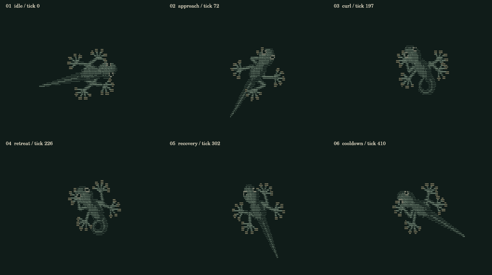
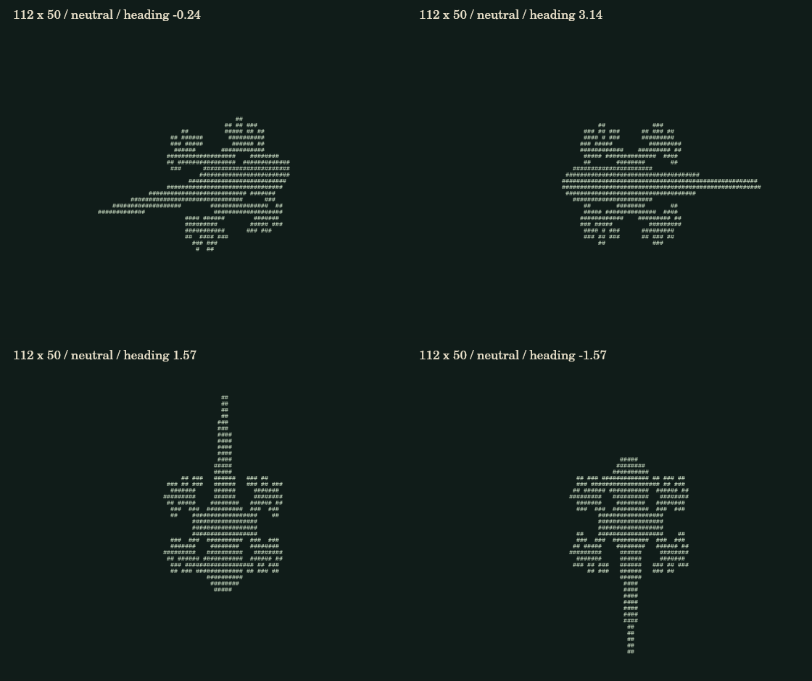
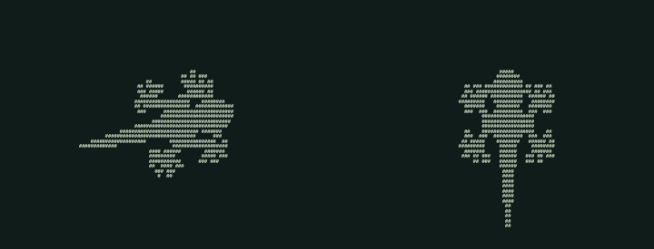

# Gecko implementation review and evidence

Date: 18 November 2026. Final integration base: `074b90a94bd3a747a68feed554e33a3ab0720f41`.
Original authoring/test base: `0e446c47b491b751d484e40db753ec725652b515`.
Branch: `feat/animal-gecko`. All additions are scoped to `species/gecko/`.

## Outcome and evidence categories

An original TypeScript gecko is implemented with a broad head, four splayed
five-pad feet, a continuous tapered tail, contact-aware creeping and an explicit
startle → retreat → recovery → cooldown sequence. The local facade/adapter does
not imply an accepted shared species contract or deployed package.

| Evidence category | Actual result | Record |
| --- | --- | --- |
| Pure model / geometry / input / replay | **13 tests pass** | `core.test.mjs`; `species-tests.txt` |
| Proposed writer adapter | **2 fixture tests pass** | `adapter.test.mjs`; no merged writer claimed |
| Browser/controller and actual demo host in stubs | **17 tests pass** | `browser.test.mjs`; DOM/Canvas bookkeeping only |
| Combined suite | **32 pass, 0 fail/skip/todo** | `species-tests.txt`, `verification.json` |
| TypeScript implementation and API fixtures | **Strict build passes; 30 expected negative cases pass** | TypeScript 5.9.3; `test/*types.ts` |
| Merged-main canonical/library regression | **25 tests pass**, build and strict TS pass | `main-tests.txt`, `main-verification.json` |
| Merged-main authoring bridge | **7 tests pass** | `main-authoring-bridge.txt`; frozen legacy fixture |
| Merged-main catalogue / generated demo | **Pass**; no tracked non-gecko diff | `main-catalogue.txt`, `main-demo-check.txt`, `main-tracked-diff.txt` |
| Existing Cuttlefish regression | **Pass**, 60 geometry scenarios, no nonfinite/clipped samples | `legacy-regression.txt` |
| Original syntax / standalone | **Pass**, rebuild leaves `dist/` unchanged | `legacy-*.txt` |
| Native Canvas output | **201 actual rendered frames**, 720×550, 20-frame/s GIF encoding | Local/generated `gecko-native.gif`; committed PNGs and `native-capture.json` |
| Independent minimum-grid recognition | **Accepted** at 112×50, including native 360px display | `small-grid-contact-sheet.png`, `minimum-native-360.png` |
| Real browser run | **Blocked before page launch**, no browser checks executed | `browser-smoke.json` |
| Cloud browser local preview | **Blocked**, `net::ERR_CONNECTION_REFUSED` | Task tool result; no screenshot/pass claimed |
| Normal-speed perceptual playback review | **Unrun** | Still/sequence review does not establish perceived timing |
| Browser/device throughput, heap, screen reader | **Unrun** | Declared budgets remain targets |
| Canonical shared integration / deployed evidence | **Pending / none** | `COMPATIBILITY.md` |

Execution environment: Linux x86_64; Node `v24.22.1`; TypeScript `5.9.3`;
esbuild `0.25.12`; installed native Canvas and FFmpeg. No dependency installation,
paid service, npm publication, merge or deployment was performed.
The coordinator merged PRs #2 and #4 during publication. This isolated branch
was then rebased onto the final integration base above, without changing gecko
runtime source. The 32 species tests and strict type fixtures were rerun there.
An independent reviewer ran the new main gates; exact commands and exits are in
[main-verification.json](main-verification.json). The 25 current canonical tests
cover parity, generated demo, public API, lifecycle and scheduler. The numerical
and seven-case bridge scripts use the frozen legacy fixture. Their passes are
recorded separately rather than treating them as current-renderer visual tests.

## Reproducible visual sequence

The exact normalized tick/sequence log is [events.json](events.json). Seed 37;
default options; initial heading −.24; 60 integer simulation ticks/second. The
capture script invokes the compiled sampler, cell mapper and Canvas painter.
Rendering never advances simulation state.

| Capture | Tick | Actual behavior |
| --- | ---: | --- |
| `frames/idle.png` | 0 | Idle |
| `frames/approach.png` | 72 | Approach |
| `frames/curl.png` | 197 | Startle |
| `frames/retreat.png` | 226 | Retreat |
| `frames/recovery.png` | 302 | Recover |
| `frames/cooldown.png` | 410 | Cooldown |
| `frames/settled.png` | 600 | Idle |



Each frame contains **9,260 original surface samples**, below the predeclared
12,288 capacity. The final seven captured frames occupy 924, 835, 866, 871, 870,
902 and 938 default-grid cells respectively. Every source hash and full state is
in `native-capture.json`. Text frames contain only declared printable ASCII plus
newlines. They are selectable cell output, unlike a claim of selectable Canvas.
The local `.gitattributes` preserves meaningful trailing blank cells and empty
rows in these fixed-width text captures; whitespace checks remain active for code.





These are native raster outputs, not browser screenshots or generated concept
art. The GIF has 201 frames at 50ms each, total 10.05 seconds. Its repeat resets
the seeded sequence intentionally; a seamless looping animation is not claimed.

The connected GitHub app rejected the GIF blob upload with `user rejected MCP
tool call` and supplied no additional reason. That upload was not retried or
routed around the rejection. The GIF is omitted from the branch and provided as
a local downloadable artifact in the task response. Run `scripts/capture.mjs`
to regenerate it. The source, raw logs and PNG evidence remain in the branch.

## Independent critique and bounded repair

An independent reviewer received the task, authoring record, raw TypeScript,
neutral contact sheet, actual captures and GIF without a requested verdict.

**Finding 1: the initial pads merged into mittens.** The original minimum-grid
and default captures each showed one connected pad-material cluster per foot.
The independently authored geometry was anatomically counted but visually weak.

| Parameter | Initial capture | Repaired capture |
| --- | ---: | ---: |
| Digit angular spacing | .51 | .66 |
| Digit reach | .12–.138 | .16–.182 |
| Pad radii | .032/.026 | .026/.023 |
| Digit strip radii | .010/.007 | .008/.006 |

The same seed, grid, headings and event sequence were recaptured. Before images
remain in [before-critique/](before-critique/). The reviewer accepted the broad
head/four feet/continuous tail recognition gate without changing the minimum
grid. Native 360×275 review also retained those anchors. A new regression protects
at least three separate pad marks per foot in all four 112×50 reviewed headings.
The analytic geometry still has five toes; **all five are not individually
resolved in every smallest-grid orientation**. Default-grid diagnostic separation
improved to three through five clusters. This diagnostic supports visual review;
it is not a general aesthetic score.

**Finding 2: unconditional pagehide cleanup broke back/forward restoration.**
The demo now retains its controller and controls on persisted pagehide. A distinct
page-suspension cause cancels work before a visibility event is required.
Pageshow refreshes size/visibility and starts a fresh accumulator, retaining user
pause. Nonpersisted navigation disposes. Two regression tests import the actual
compiled demo into the stub harness to exercise the controls across that cycle.

The catch-up loop also checks `running()` before every step, with a callback-pause
regression. The previous code already cleared its accumulator on suspension, so
extra ticks were not reproduced from that callback alone; this is explicit
hardening, not a falsely reported reproduced bug. Invalid null/symbol/prototype
view inputs were also checked without loosening accepted numeric boundaries.

Independent review accepted closure of this bounded loop. Its post-fix source
review found no remaining blocker to a **species-local draft PR**, subject to the
unrun acceptance below. The final root verification included the added pad
regression and latest type fixtures, yielding the 32-test result above.

## What the tests actually establish

Core tests compare exact state and cells for the same event log rendered every
1/2/5 ticks; different deliberate inputs diverge. Invalid options/events are
atomic, sequence IDs increase, guide coordinates are normalized, and busy
startles do not extend response clocks. Default/minimum/maximum option runs cover
3,600 contact steps. At least three feet stay planted, exact FL→RR→FR→RL swing
order is retained, and the actual sampled pad positions plus fan angles remain
fixed during sustained stance. Shoulder/elbow/palm reach remains within .19/.25
segments; the attached tail tapers monotonically and keeps continuous length.

Geometry sweeps cover full in-plane turns, finite bounds, all option extremes,
sample identity, read-only sampling and the smallest/largest ASCII grids. These
are not tests of frontal/profile 3D anatomy, which is unsupported.

Lifecycle stubs cover 10,000 guide events coalescing to bounded intents, reduced
motion, static deliberate curl, pause/update/reset, hidden/offscreen/zero-size
composition, backlog dropping, DPR/backing caps, failed setup, callback failure,
late callbacks, independent instances, repeated disposal and actual host-module
page lifecycle. They prove owned-resource bookkeeping, not browser heap behavior.

Strict type fixtures exercise source-based declarations, closed input/config
schemas, discriminated states/results, readonly snapshots, reset-only seed,
controller methods, the proposed writer and the typed species facade. Module
imports during Node tests require no DOM. No framework adapter is claimed.

## Reproduction and recorded commands

The exact successful commands and exit codes are in [verification.json](verification.json).
Run from the repository root with an existing TypeScript compiler on PATH or
`GECKO_TSC_JS` pointing to its `lib/tsc.js`:

```sh
node species/gecko/scripts/build.mjs
node species/gecko/scripts/build.mjs --types
node --test species/gecko/test/*.test.mjs
node scripts/check-engine.cjs
node --check dist/artwork.js
node --check dist/app.js
python3 scripts/build-standalone.py
git diff --exit-code -- dist/
```

With the repository's declared TypeScript 5.9.3 development dependency available,
the newly applicable merged-main checks are:

```sh
node scripts/build.mjs
node --test test/*.test.mjs
node node_modules/typescript/bin/tsc -p tsconfig.json --noEmit
node scripts/build-demo.mjs --check
python3 scripts/check-catalogue.py
node scripts/check-authoring-bridge.mjs
```

These used an existing compiler through an ignored local dependency symlink;
no dependency download or shared manifest edit was required. Shared package
packing was not repeated because no shared export/source changed, and this
species is not claimed as part of that package.

`scripts/standalone.mjs` uses an existing esbuild module to produce `gecko.html`.
`scripts/capture.mjs` uses an existing native Canvas/FFmpeg installation; no
renderer stub is used for those frames. The reviewed skill's bounded validator
was run against `gecko.authoring.json`; `spec-validation.txt` records its result.

The optional actual-browser test can be reproduced independently:

```sh
node species/gecko/scripts/browser-smoke.mjs
```

It uses the offline `gecko.html` directly. In this environment Chromium exited
before opening a page with `socket() failed: Operation not permitted` and a
Crashpad `ptrace: Operation not permitted` diagnostic. The JSON records
`status:"blocked"`, `browser:null`, `checks:[]`. Browser security/settings were
not changed to bypass the failure. The supported cloud browser also could not
reach the local preview; no browser success is inferred from native Canvas.

## Unrun acceptance and ownership

- Normal-speed perceptual review of the actual animation. The reviewer inspected
  stills/sequence and GIF metadata, not normal-speed playback.
- Actual browser keyboard traversal, touch/scrolling, live reduced-motion,
  resize/visibility/bfcache delivery and full demo layout.
- Real phone display/input; screen-reader narration and contrast/zoom audit.
- Predeclared desktop p95 ≤16ms work target (2s warmup, 30s collection), mobile
  throughput and allocation/long-session heap. No frame-time or FPS pass is claimed.
- Canonical renderer/species adapter, material and lifecycle consolidation,
  public package export and packed consumer tests after the coordinator accepts
  that shared contract. Current PR #2 is still cuttlefish-only.
- Catalogue activation, npm publication, GitHub Pages or other deployment.

The implementation is suitable for review as an isolated draft. These gaps are
explicit acceptance work, not stubbed passes or claims that the gecko is shipped.
