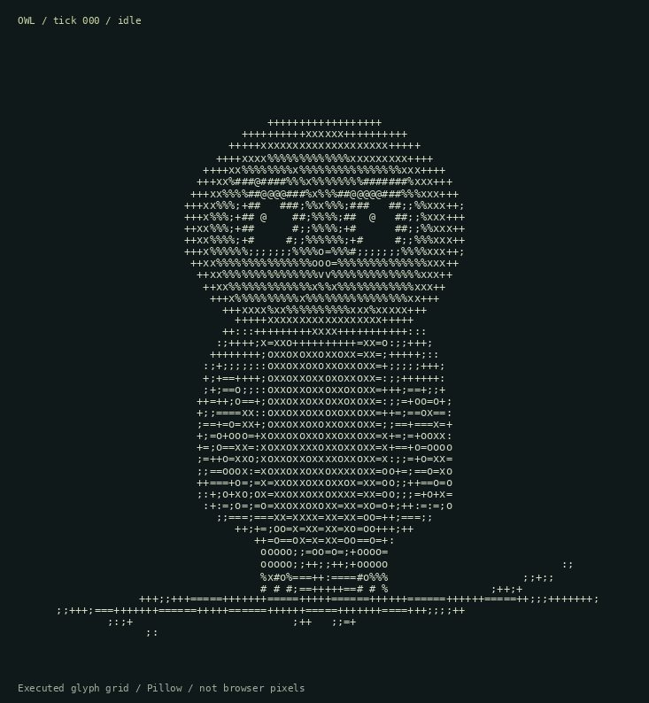

# Owl / The night watch

An original perched owl built from analytic geometry and printable characters. Move the pointer or use **Guide** for bounded head attention. **Invite a reaction** gives a blink, a fine feather ruffle, a controlled wing stretch, recovery and cooldown. The feet stay planted.

**TypeScript source first. Integrated private review candidate.** The explicit `ascii-animals-review/owl` package factory and generated `dist/owl/` demo wrap this original source. See [current integration API/evidence](../../docs/OWL-API.md). Historical authoring evidence below remains separately labelled. The shared Cuttlefish renderer is unchanged.

## Twilight director / The night shift

The current demo adds three authored scenes, one or two stable Owl identities,
perch composition, different dispositions, targeted cues and deliberate still
poses. Existing consumers retain the original solo behavior unless they supply
the optional `director` configuration. The renderer remains DOM text over this
same original Owl geometry.

Read the [director API and typed example](../../docs/OWL-API.md#optional-twilight-director),
[pre-code brief](DIRECTOR-BRIEF.md), [independent closing review](DIRECTOR-REVIEW.md),
and [current validation and remaining gates](DIRECTOR-VALIDATION.md).
The [new scene contact sheet](evidence/director/director-contact-sheet.png) and
[Last light replay](evidence/director/roost.gif) show executed ASCII output,
rasterized with Pillow. They are not native-browser recordings. The original
single-Owl evidence below is retained as historical provenance.



The GIF is the actual output of the compiled species and its logical text sampler, rasterized using an installed monospace font. It samples a 60-tick simulation at 12 frames/second and repeats the recorded eight-second sequence. It is **not a browser recording**. Its repeat restarts the fixture; it is not claimed as the period of the owl's idle motion.

## Run the local demo

From the repository root:

```sh
python3 -m http.server 8765 --bind 127.0.0.1
```

Open <http://127.0.0.1:8765/species/owl/demo/>. The committed `build/` files are generated JavaScript and declarations; viewing the demo needs no package installation, external font or service. Use an HTTP server for the ES modules rather than `file:`. This does not deploy anything.

The demo provides native keyboard/touch controls for reaction, pause, reset, attention direction, detail, head range and reaction strength, plus a real text export. Pointer motion only guides attention; background clicks do not start a reaction. System reduced motion keeps the display static; deliberate Guide/React changes one still pose. A host below 350×330 CSS pixels also uses still poses. Readability is accepted only at the declared 64×36 minimum grid and approximately 350×330 display target.

Actual browser launch was blocked in the authoring environment before a page opened. The implementation, numerical tests, mock host tests and code-derived image evidence are available; browser typography/interaction and normal-speed human review remain acceptance work. See [validation](VALIDATION.md).

## Use the typed species locally

```ts
import {
  createOwl,
  renderOwlGrid,
  type OwlInput,
} from './build/index.js';

const owl = createOwl({
  seed: 42,
  headYawLimitDeg: 28,
  reactionStrength: 0.8,
});

const input: readonly OwlInput[] = [
  { tick: 1, seq: 0, type: 'attention', x: 0.7, y: -0.2 },
];
const result = owl.advance(1, input);
if (result.state.behavior.kind === 'response') {
  console.log(result.state.behavior.phase); // blink | ruffle | stretch
}

console.log(renderOwlGrid(owl.getState(), { cols: 96, rows: 54 }).text);
owl.update({ featherContrast: 0.65 });
owl.reset(42);
owl.dispose();
```

This relative import is real and backed by the included declarations. The package now provides `ascii-animals/owl`; `createArtwork({species:'owl'})` is deliberately unsupported. [Typed example](examples/typed-owl.ts) and [positive/negative fixtures](tests/types.ts) compile against the emitted declarations.

The core has no DOM, font, clock or random-number dependency. Its snapshots, nested configuration, behavior and attention objects are frozen. `sample()` returns the original geometry separately from the demo's orthographic character sampling.

### Species options

`createOwl(options)` validates before creating state. Unknown keys, strings, nonfinite values, out-of-range numbers and explicit `undefined` field values reject rather than coercing. Omitted fields use these defaults. `schemaVersion` is exactly `1`.

| Option | Default | Accepted values | Purpose |
| --- | ---: | --- | --- |
| `seed` | 7 | Integer 0–4,294,967,295 | Repeatable identity/idle phase; changed only by reset |
| `headYawLimitDeg` | 34 | 0–45 | Horizontal head bound; never unlimited spin |
| `headPitchLimitDeg` | 12 | 0–20 | Vertical head bound |
| `attentionSmoothing` | 0.10 | 0.01–0.25 | Fraction of target difference applied each tick |
| `idleAmplitude` | 0.30 | 0–1 | Gentle head/breathing envelope; zero removes it |
| `reactionStrength` | 0.85 | 0–1 | Ruffle and wing extension amplitude |
| `featherContrast` | 0.55 | 0–1 | Procedural plumage contrast |
| `blinkIntervalTicks` | 240 | Integer 120–1,200 | Seeded idle blink interval |
| `blinkTicks` | 18 | Integer 12–60 | Reaction blink duration |
| `ruffleTicks` | 36 | Integer 18–120 | Fine plumage response duration |
| `stretchTicks` | 60 | Integer 36–180 | Wing extension duration |
| `recoveryTicks` | 48 | Integer 24–180 | Smooth return to folded wings |
| `cooldownTicks` | 120 | Integer 30–600 | Ignore further reactions during this period |

The demo deliberately starts reaction strength at `0.8`; the species default is `0.85`. Its control displays that chosen demo value. Reproduction fixture/evidence uses the species defaults.

### Core methods and semantics

| Method | Behavior |
| --- | --- |
| `advance(tick, inputs?)` | Requires exactly the next integer tick; returns immutable `OwlStepResult` with state and accepted/ignored reaction counts. Tick rate is 60/s. |
| `update(patch)` | Validates the entire patch atomically; preserves seed/tick/sequence/behavior. Head limits clamp the current head pose. Active reactions retain captured timing and strength until their cycle finishes; updates apply to the next cycle. |
| `reset(seed?)` | Resets tick to 0, sequence to -1, target, pose and behavior; keeps configured options. An omitted seed reuses the current seed. |
| `getState()` / `getOptions()` | Return immutable local snapshots. |
| `sample()` | Original analytic geometry and fixed attachment landmarks. No simulation step. |
| `dispose()` | Idempotent. All later core methods except reading `disposed` throw. No background resources exist in the core. |

The browser owns playback; pure `advance` has no pause flag. Host `reset` and `update` preserve explicit pause and motion policy. Changing timings mid-reaction does not teleport a phase.

### Inputs and reproducibility

`OwlInput` is a discriminated union:

```ts
{ tick, seq, type: 'attention', x, y }
{ tick, seq, type: 'leave' }
{ tick, seq, type: 'react' }
```

Coordinates are normalized CSS-rectangle positions, with x rightward and y downward. Finite values outside `[-1,1]` clamp; nonfinite/non-numeric values reject. Every event must target the next tick and have a strictly increasing nonnegative safe-integer `seq`. A batch has at most 16 events and validates completely before state changes. Last attention/leave wins. One reaction may start per tick; repeats during response/recovery/cooldown are counted and ignored, never queued for later.

`OwlBehavior` distinguishes `idle`, `approach`, `response` (`blink`, `ruffle`, `stretch`), `recovery` and `cooldown`. The same version/configuration/seed and [ordered event fixture](fixtures/replay.json) produce identical state and cells with rendering grouped every 1, 2 or 5 ticks in the tested runtime. Rendering never advances simulation. Different browser input-delivery timings are not equivalent logs. Cross-engine trigonometry/pixel identity and arbitrary serialized-state restoration are not promised.

## Browser host

```ts
import { mountOwl } from './build/index.js';

const host = document.querySelector<HTMLElement>('#owl')!;
const preview = mountOwl(host, {
  owl: { seed: 7 },
  grid: { cols: 96, rows: 54 },
  paused: true,
});

preview.guide(0.8, -0.3); // deliberate still pose while paused
preview.react();          // complete static wing pose; does not start a loop
preview.setPaused(false); // still respects system reduced motion and other causes
preview.update({ headYawLimitDeg: 25 });
preview.reset();          // keeps pause/motion policy
preview.dispose();
```

Give the host an explicit width/height. The host renders an owned `<pre>` using `textContent`; no Canvas context is required. `getSnapshot()` separates the explicit-tick `simulation`, the `displayed` pose and the actual `grid`. `exportText()` returns exact printable cells rather than a screenshot. `getStatus()` remains available after disposal; all other host operations reject, except repeated `dispose()`.

`mountOwl` options are `owl`, `grid`, `paused`, `frameSource`, `onStatus` and optional `environment` injection for tests/embedding. Default pause is false, subject to policy. Default grid is 64×36 for hosts under 550px wide or 440px high, otherwise 96×54. Explicit `setGrid(options)` replaces the grid options; use coherent pairs such as 64×36, 96×54, 128×72 or 160×90. Browser cell aspect is fixed at `0.55`; the pure diagnostic sampler separately accepts `0.45–0.70` with physical aspect `cols × cellAspect / rows` between `0.92` and `1.90`.

Pause, reduced motion, document visibility, offscreen state, zero size, insufficient display size and disposal compose independently. Clearing one cannot override another. Suspension cancels owned RAF or scheduler subscription, clears pending actions and resets timing. The current pose freezes; deliberate static actions can replace it. Stale attention clears on the next resumed simulation tick unless a fresh target supersedes it. Hidden time is not replayed.

The preview takes at most five catch-up ticks/frame and reports dropped milliseconds. Pointer traffic coalesces to one attention/leave and one reaction. A supplied `frameSource.subscribe(callback)` may reuse the merged scheduler's structural shape, but the owl only calls its own unsubscribe function. It never disposes the shared scheduler. Missing animation or motion-query capability gives a static preview; missing observers fall back to window resize/scroll and explicit-action measurements. No React/Vue/Svelte adapter is claimed.

## Bounds, original construction and integration

The model has **57 analytic surfaces**, capped at 96; at most 14,400 logical cells, one owl per preview, no particles and no canvas backing store. Both eyes move with the head. Fixed shoulders support independently lagged wings of constant length; both feet stay on the branch. Maximum extension is 48° beyond the folded wing's 7° baseline, scaled by reaction strength. Full-profile/rear views are unsupported.

No online ASCII drawing, reference ray implementation, model, image or font binary was copied. The rounded head/body and eye placement were informed by the primary references recorded in [the pre-code authoring record](AUTHORING.md). See [provenance](provenance.json). No project license or release decision is changed.

[Compatibility](COMPATIBILITY.md) records the exact merged base and merged TypeScript foundation. `writeOwlSamplesToProposal` is a small explicit bridge to PR2's **non-exported** writer sketch. It requires host-chosen units, y-axis and material IDs, validates capacity before writing, and throws on refusal. Its ordinal `stableSeed` is deterministic for an identical sampled grid, not anatomical identity across motion/resolution. A rejecting writer may have received earlier samples; discard that destination frame. This is a proposal, not canonical-renderer acceptance.

## Build, test and reproduce evidence

From this directory, with Node and TypeScript **5.9.3** already available:

```sh
npm run build
npm run typecheck
npm test
```

The local private manifest pins TypeScript as a development dependency. The build never installs packages. Set `OWL_TSC=/absolute/path/to/typescript/lib/tsc.js` to use an existing compiler; runtime use needs none. All generated `.js` and `.d.ts` files in `build/` come from `src/`.

```sh
node scripts/capture-logical.mjs
python3 scripts/render-evidence.py
```

The second command needs an existing Pillow installation and installed monospaced font (`OWL_FONT` can select it). No font is downloaded. Raw cells, tick/phase data, hashes and font provenance accompany the PNGs/GIF.

For actual-browser acceptance on a supported machine, start the local server, then run `node scripts/browser-smoke.mjs` with an existing Playwright installation. `OWL_PLAYWRIGHT`, `OWL_CHROMIUM` and `OWL_BROWSER_URL` may point to those existing local resources. See [validation](VALIDATION.md) for what ran, what failed, and what remains unrun.

## Evidence and review

- [Behavior contact sheet](evidence/contact-sheet.png) and [minimum-grid/silhouette sheet](evidence/small-grid-sheet.png).
- [Independent review and corrections](REVIEW.md).
- [Executed test output](evidence/tests.tap), [skill validator/reference checks](evidence/skill-checks.txt), and [original Cuttlefish regression](evidence/cuttlefish-regression.log).
- [Validation scope and remaining acceptance](VALIDATION.md).

Everything added by this branch is under `species/owl/`. The shared renderer, registry, exports, root README, workflows and deployed page are unchanged.
